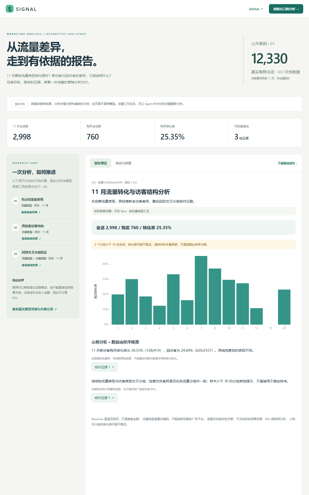

# Signal · 营销分析 Agent

面向营销运营的分析与报告工作台：简单需求直接使用 **报表 Skill**；复杂目标进入 **研究 Loop**，通过工具查询、假设检查和证据关联生成报告草稿，再由用户预览、修改和确认发布。

这是使用开放数据的独立工程实现，不是任何公司的官方项目或生产源码。项目不执行真实投放，不把分析完成解释为业务增长。

**[打开在线交互案例 →](https://ovo-daisy28.github.io/marketing-analysis-agent/)** · 无需注册、密钥或安装。点击分析步骤查看查询证据，切换“结论与依据”，下载可离线阅读的报告。在线案例是明确标注的固定示例；真实模型分析、修改与发布通过下方启动步骤体验。



## 能做什么

- 真实模型自主选择工具；另提供明确标识的确定性模拟模式。
- 固定指标口径和数据合同，支持筛选、单维/双维聚合与空数据处理。
- 受控 HTML、G2 图表、隔离预览、修改版本与幂等发布。
- Goal / Hypothesis / Evidence / Claim 持久化，逐轮构建上下文。
- 独立 Worker、PostgreSQL 租约、检查点、失败重试、预算与无进展停止。
- 登录会话、CSRF、工作区隔离、只读 SSE 及执行事件回放。
- 独立 CSV 数值核对、固定案例、真实模型对照和浏览器测试。
- 免登录公开案例、结论到证据表格的下钻、已发布快照的 HTML / CSV 导出。

项目没有独立知识库模块；少量分析规则、指标和模板跟随代码版本维护。

在线截图来自固定案例；真实模型轨迹、对照结果与失败样例见 [验证记录](docs/validation.md)。

## 启动

需要 Python 3.12/3.13、[uv](https://docs.astral.sh/uv/)、Node.js 24。正式部署使用 PostgreSQL；本地单 Worker 体验允许 SQLite。

### Docker Compose

```sh
cp .env.example .env
# 模拟体验保留 MODEL_MODE=mock；真实模型填写 LLM_* 并设 MODEL_MODE=live。
docker compose up --build -d
```

打开 <http://localhost:8000>，先查看案例，点击“创建自己的分析”进入工作区。Compose 先迁移数据库、导入数据，然后启动 API 与 Worker；默认仅绑定本机端口。数据库密码可通过 `POSTGRES_PASSWORD` 修改。

### 本地开发

```sh
uv sync --frozen
cp .env.example .env
# 无 PostgreSQL 时将 DATABASE_URL 改为 sqlite:///./data/local.db
uv run python -m marketing.cli init-db
uv run python -m marketing.cli import-data
cd web
npm ci
npm run build
cd ..
```

分别在两个终端运行：

```sh
uv run uvicorn marketing.api:app --host 127.0.0.1 --port 8000
uv run python -m marketing.worker
```

Windows 可使用 `./start.ps1` 完成初始化与后台启动，使用 `./stop.ps1` 关闭该脚本启动的进程。脚本不覆盖已有 `.env`。

API 文档：<http://localhost:8000/docs>。前端开发服务使用 `npm run dev`，此时将 `APP_ORIGIN` 设置成实际 Vite 地址，并重启 API。

## 模型配置

```dotenv
MODEL_MODE=live
LLM_BASE_URL=https://your-provider.example/v1
LLM_MODEL=your-model-id
LLM_API_KEY=your-private-key
```

支持 OpenAI 风格的非流式 Chat Completions 工具调用。UI 的 SSE 展示执行事件，不宣称提供模型 Token 流。模型字段由你的服务供应商决定。

某些兼容网关返回 `{}{...}` 形式的工具参数。只有确实观察到该行为时，启用 `TOOL_ARGUMENTS_EMPTY_PREFIX_FIX=true`；它仅删除多余的前导空对象，并记录原参数及修正事件，不做一般性的 JSON 猜测修复。默认关闭。

`.env`、运行数据库、完整轨迹和下载文件均在 Git 忽略范围中。请勿提交密钥。

## 试用任务

**直接报表：**“生成 11 月按流量类型分组的购买转化率报表，注明数据限制。”

**多轮研究：**“比较不同流量类型的购买转化表现，进一步检查新访客与回访者差异，检验一个假设并生成有证据的报告。”

**证据不足：**“计算广告成本与 ROI。”系统应说明数据缺口，不能编造金额。

完成后在报表中心修改标题、图表或月份。修改月份会创建新证据与新版本，并移除旧范围下的结论。已发布版本保留结果快照。

点击报告结论下的“核对证据”，查看对应筛选条件、样本量、分组表格与计算口径。发布后可以下载无脚本的 HTML 报告或 CSV；HTML 包含证据表格及锚点，可离线阅读，也可通过浏览器打印为 PDF。

## 两分钟体验路线

1. 在线案例：点击“再检查访客结构”，在证据表中核对新访客与回访者的分子、分母。
2. 切换“结论与依据”：验证描述性差异与因果结论的边界，下载报告离线打开。
3. 本地启动：创建工作区，运行一条报表任务，观察步骤与证据自动更新。
4. 修改月份：确认旧范围的结论被移除，再发布新版本并导出。

固定案例由 `uv run python -m scripts.build_showcase` 从指定 SHA-256 的 UCI 数据生成，不能读取私人工作区。GitHub Pages 仅发布前端和此公开案例；没有模型密钥、账号数据库或在线写入接口。

## 数据和计算

默认数据为 [UCI Online Shoppers Purchasing Intention](https://archive.ics.uci.edu/dataset/468/online+shoppers+purchasing+intention+dataset)，共 12,330 个会话。数据以下载文件的 SHA-256 标记版本。

购买转化率为 `购买会话数 / 全部会话数`，使用相同筛选条件。总体比率由总分子与总分母计算，不能平均各组比率；零分母返回 `null`。

Revenue 是购买布尔标记。流量类型和地区是编码，不映射为虚构广告平台或地名。数据不提供完整日/周时间轴、广告成本和收入金额。观察到的差异不构成因果证据。

```sh
uv run python -m marketing.cli contract
```

该命令从实际 Pydantic 模型及指标注册表输出数据合同，避免维护另一份不一致的字段列表。

## 验证和评测

```sh
uv run pytest -q
uv run ruff check marketing tests scripts
cd web
npm run build
npx playwright install chromium
npm run test:e2e
```

浏览器测试要求 API 和 Worker 已运行，建议使用 `MODEL_MODE=mock`。Windows 可设置 `PLAYWRIGHT_CHANNEL=msedge` 使用已有 Edge。

真实 PostgreSQL 的并发验证：初始化一个独立测试库、导入数据，并设置对应 `DATABASE_URL` 后运行：

```sh
uv run python -m scripts.check_postgres
```

模型评测默认有保守预算检查，运行前按案例数量明确设置预算：

```sh
uv run python -m scripts.evaluate --suite eval/development.json --limit 3 --token-budget 240000
uv run python -m scripts.evaluate --variant both --limit 43 --workers 3 --token-budget 6880000
```

固定集共 60 个场景：43 个模型任务和 17 个映射到工程测试的场景；工程断言不计入模型任务完成率。开发集有 30 个不同查询条件的任务。评测产物记录失败、超时、数据哈希、调用量与完整轨迹，见 [评测说明](docs/evaluation.md) 和 [验证结果](docs/validation.md)。

## 代码阅读顺序

准备让 DeepSeek 或其他模型带学时，从 **[学习入口与可复制提示词](docs/learning-guide.md)** 开始。它按真实函数组织课程，并列出当前未实现的能力，避免把规划或参考项目当成现有代码。

1. `marketing/analytics.py`、`schemas.py`：数据合同和确定性计算。
2. `skills/report/`、`marketing/services.py`：Skill、报告状态与版本。
3. `marketing/tools.py`：模型能调用的能力和后端校验。
4. `marketing/context.py`、`worker.py`：上下文、主循环、检查点与预算。
5. `marketing/api.py`、`web/src/`：登录、工作台、隔离页面与 SSE。

详细说明见 [架构与取舍](docs/architecture.md)、[运行与故障排查](docs/operations.md)。

## 参考与许可

[DeerFlow](https://github.com/bytedance/deer-flow) 用于研究运行时设计，[data-agent-skill](https://github.com/aliyun/data-agent-skill) 用于研究 Skill 组织，[DB-GPT](https://github.com/eosphoros-ai/DB-GPT) 用于检查数据分析到报告的流程。具体参考提交记录于 `docs/references.json`；本仓库没有复制这些项目的源码。

体验完善借鉴 DeerFlow 的免登录只读案例、阿里 `data-agent-arcvis-skill` 的报告与产出关联，以及 [Evidence](https://github.com/evidence-dev/evidence) 的代码化报告和静态交付思路。实现与取舍见 [架构说明](docs/architecture.md#体验与交付的设计取舍)。

独立代码使用 MIT 许可。UCI 数据采用 CC BY 4.0，引用：Sakar, C. & Kastro, Y. (2018), DOI: [10.24432/C5F88Q](https://doi.org/10.24432/C5F88Q)。第三方运行依赖保留各自许可证。

## 已知边界

本项目是可复现工程作品，不声称已经服务真实企业客户。完成校验检查产物与证据引用的结构，不自动证明所有自然语言结论正确。业务结论需要复核。首版使用个人工作区，未实现企业 SSO、组织邀请、分布式限流、容灾及真实营销执行接口。
