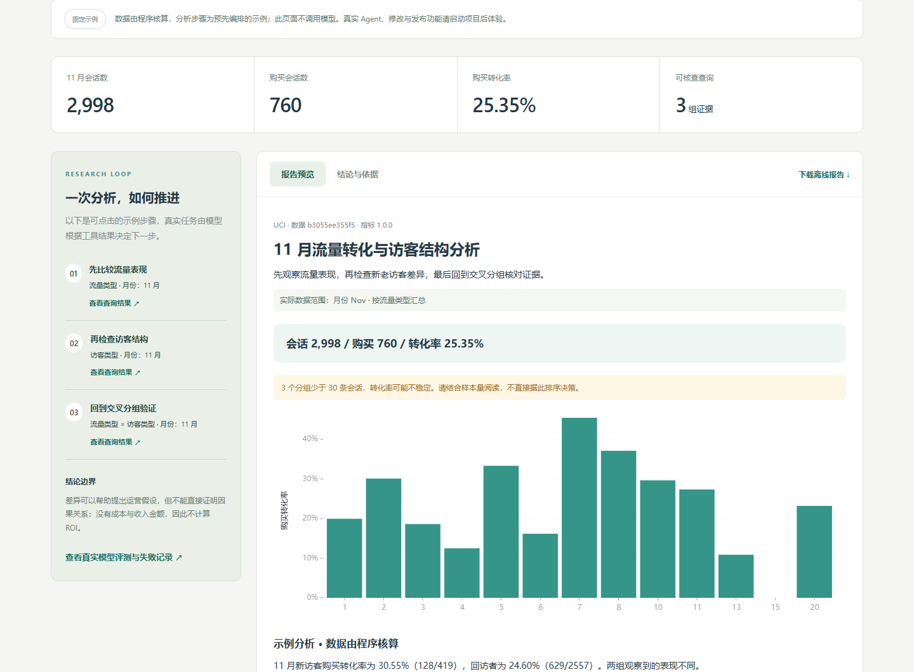
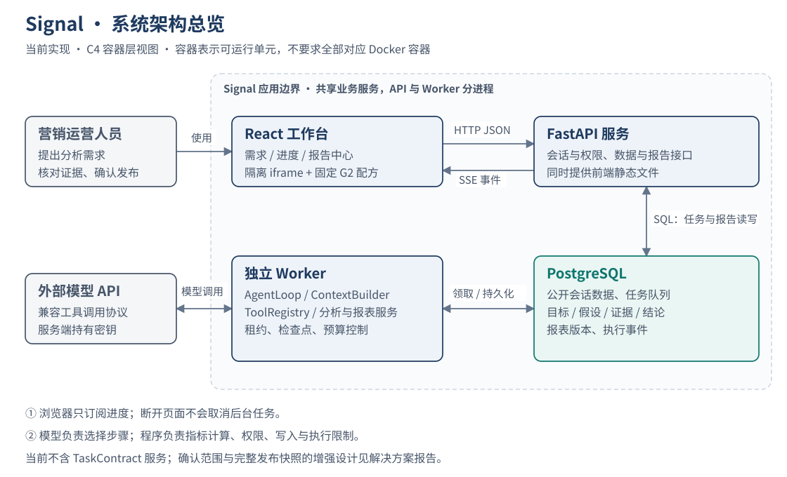

# Signal · 营销分析与报告 Agent

把营销数据问题转成**数字可核算、结论有依据、可修改并确认发布的报告**。

**[体验在线案例 →](https://ovo-daisy28.github.io/marketing-analysis-agent/)**　·　**[阅读解决方案](docs/solution-analysis.md)**　·　**[本地运行](docs/operations.md)**　·　[文档导航](docs/README.md)

> 独立公开 POC，使用 UCI 电商会话数据。在线案例是无需注册和密钥的固定示例；真实模型分析需启动本地服务。项目不代表为产品对标厂商实施客户项目。

[](https://ovo-daisy28.github.io/marketing-analysis-agent/)

## 解决什么问题

营销运营需要反复筛选数据、比较转化表现并整理报告。Signal 将这条流程拆成两条共用执行基础的路径：

| 用户需求 | 系统怎么处理 | 交付内容 |
|---|---|---|
| “生成 11 月各流量类型的转化报告” | 报表 Skill 组织指标合同、模板和图表配方 | 可预览、修改和发布的网页报告 |
| “低转化表现是否与访客结构有关？” | 研究 Loop 选择工具、检查假设、积累证据 | 带引用、样本量和分析限制的报告草稿 |
| “这个数字或判断从哪里来？” | 从结论下钻至证据，查看查询条件与聚合结果 | 可核对的分子、分母、范围和数据版本 |

数据中的月份为历史类别，不表示当前月份。观察到的差异不等于因果关系；缺少成本与收入金额，不能计算广告 ROI。

## 两分钟体验

1. 打开在线案例，点击“再检查访客结构”，查看新访客与回访者的分组数据。
2. 切换“结论与依据”，核对结论、样本量和证据；下载可离线阅读的 HTML 报告。
3. 想验证真实工具调用时，在本地创建自己的分析，观察执行步骤、修改草稿并确认发布。

固定案例用于理解业务流程，真实运行记录和失败样例见[验证记录](docs/validation.md)，两者不混作模型能力证据。

## 系统如何工作



模型选择下一步分析与工具；程序负责指标计算、参数校验、权限、持久化和停止条件。浏览器断开后，后台 Worker 继续执行任务。

**技术栈：** Python · FastAPI · Pydantic · SQLAlchemy · PostgreSQL · React / TypeScript · G2 · Docker Compose。Agent 运行时为自建循环，采用 function calling，不依赖 LangGraph 或多 Agent。

## 三项核心设计取舍

| 设计 | 解决的问题与选择 |
|---|---|
| **受控报表 Skill** | 用固定模板和图表配方约束输出，指标由程序计算；当前不执行模型生成的任意 SQL、Python 或 JavaScript。[设计说明](docs/architecture.md#report-skill) |
| **结构化研究 Loop** | 保存 Goal / Hypothesis / Evidence / Claim，逐轮注入上下文；完整证据按 ID 读取，避免无限堆叠历史。[设计说明](docs/architecture.md#research-loop) |
| **可恢复执行与交付** | 数据库队列、租约、工具幂等和预算限制控制任务；人工发布与研究完成分开。[运行保障](docs/architecture.md#reliability) · [接口](docs/api.md) |

## 已验证什么，还有哪些不足

| 证据 | 结果与范围 |
|---|---|
| 2026-11-23 本地工程记录 | 37 项 pytest、前端构建及 2 项接口文档浏览器检查通过；是该日期记录，不是本次文档整理重新测试 |
| 历史模型对照 | 43 个任务 × 2 个版本，共 86 次运行；未证明结构化状态版本整体优于普通历史版本 |
| 历史独立数值核对 | 181 个聚合结果与 CSV 独立计算一致；不等于自然语言结论正确率 |
| 下一步改进（拟议） | 任务范围确认、证据适用性检查、失效结论发布门禁及完整交付快照，尚未实现 |

[查看评测方法](docs/evaluation.md) · [查看完整结果与限制](docs/validation.md) · [查看失败案例](docs/bad-cases.md) · [查看优化设计](docs/solution-analysis.md#target-design)

## 本地快速运行

安装 Docker 与 Compose，在项目根目录执行：

```sh
cp .env.example .env
docker compose up --build -d
```

PowerShell 可用 `Copy-Item .env.example .env`。仅在首次初始化时复制配置，不覆盖已有 `.env`。

打开 <http://localhost:8000>。默认 `MODEL_MODE=mock` 为确定性模拟；真实分析需在服务端 `.env` 配置 `LLM_*` 并设置 `MODEL_MODE=live`。使用远端模型 API 不需要本机 GPU。

完整配置、Windows 启动脚本、模型兼容和排障见[运行指南](docs/operations.md)。运行后可打开 <http://localhost:8000/docs> 查看本地接口文档。

## 数据与能力边界

默认数据为 [UCI Online Shoppers Purchasing Intention](https://archive.ics.uci.edu/dataset/468/online+shoppers+purchasing+intention+dataset)，包含 12,330 个购物会话，以文件 SHA-256 标记版本。购买转化率 = 购买会话数 / 全部会话数；总比率不平均各组百分比，零分母返回 `null`。

Revenue 是购买标记，不是收入；流量类型是编码，不映射为虚构广告平台。当前没有完整日／周时间轴、投放执行接口、企业 SSO、团队权限或生产规模 SLA。工作区隔离用于任务与报告，公开 UCI 数据是共用数据源。

## 参考与许可

参考 [DeerFlow](https://github.com/bytedance/deer-flow) 的长任务运行思路、[阿里云 data-agent-skill](https://github.com/aliyun/data-agent-skill) 的 Skill 组织、[DB-GPT](https://github.com/eosphoros-ai/DB-GPT) 的数据分析交付流程，以及 [Evidence](https://github.com/evidence-dev/evidence) 的静态报告交付思路。源码为独立实现；版本及具体取舍见[参考记录](docs/references.json)与[架构说明](docs/architecture.md#references)。

代码采用 MIT；UCI 数据采用 CC BY 4.0，Sakar & Kastro (2018)，DOI：[10.24432/C5F88Q](https://doi.org/10.24432/C5F88Q)。第三方依赖保留各自许可。
