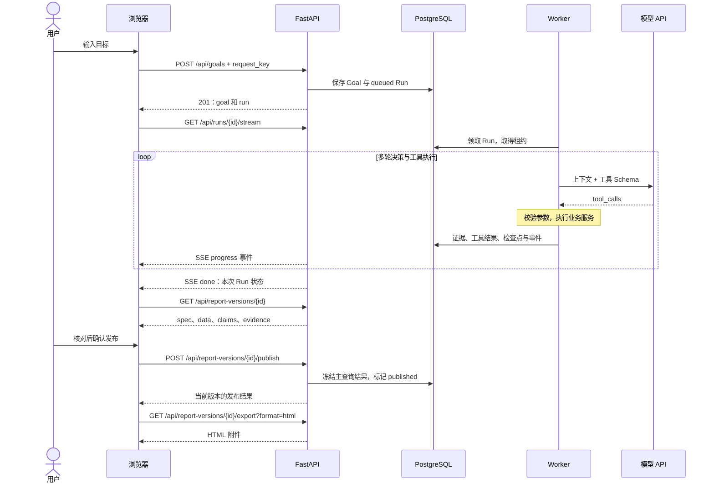

# 接口与交互流程

[项目首页](../README.md) · [文档导航](README.md) · [当前架构](architecture.md) · [运行指南](operations.md)

**范围：当前实现，核对日期 2026-11-24。** 字段最终以 [Pydantic 模型](../marketing/schemas.py)、[API 路由](../marketing/api.py)和运行后的 `/openapi.json` 为准。启动后在 <http://localhost:8000/docs> 交互查看，资源由本地服务提供。

## 1. 两种调用入口

浏览器通过 HTTP API 使用身份会话；模型通过 function calling 向 Worker 提议工具调用。ToolRegistry 直接调用 Python 业务服务，不需要再次发 HTTP 请求。当前用户与工作区来自服务端上下文，不能由模型传入替换。

| 入口 | 传入内容 | 程序职责 |
|---|---|---|
| HTTP API | 目标、修改、发布等用户请求 | 身份、CSRF、对象所属工作区、请求幂等 |
| ToolRegistry | 工具名称和 JSON arguments | Pydantic Schema 校验、工具白名单、目标内证据访问、事务执行 |

<a id="sequence"></a>
## 2. 创建分析到发布的接口时序



图示为正常完成路径。`done` 表示当前订阅结束，可能对应等待、失败或停止，不能仅凭收到事件判断报告成功。SSE 断开不会取消 Run。

## 3. 当前 HTTP API 清单

下表路径均以前缀 `/api` 开始。业务接口要求登录，写请求需要有效 CSRF；注册／登录执行来源检查与进程内限流。

| 功能 | 方法与路径 | 输入／输出要点 |
|---|---|---|
| 注册／登录／身份／退出 | `POST /auth/register`、`POST /auth/login`、`GET /auth/me`、`POST /auth/logout` | 登录设置 HttpOnly Session Cookie，返回 `csrf` |
| 数据合同 | `GET /data/contract` | 可用指标、维度、限制和最新数据集 |
| 临时聚合 | `POST /data/query` | `group_by` + `filters`；查询最新公开数据 |
| 创建分析 | `POST /goals` | `objective`、`mode`、`criteria`、`request_key`；返回 201 |
| 目标列表／详情 | `GET /goals`、`GET /goals/{id}` | 工作区内目标、研究状态与 Run |
| 补充与续接 | `POST /goals/{id}/continue` | `instruction`、`request_key`；创建新 Run |
| 取消运行 | `POST /runs/{id}/cancel` | 停止后续调度，保留已有产物 |
| 进度 | `GET /runs/{id}/stream`、`GET /runs/{id}/events?after=0` | SSE 订阅或 JSON 补读 |
| 报告列表／版本 | `GET /reports`、`GET /report-versions/{id}` | 指定版本载荷与关联证据 |
| 修改报告 | `POST /reports/{id}/revise` | `base_version_id`、`spec`、可选 `query`、`request_key` |
| 确认发布 | `POST /report-versions/{id}/publish` | **当前无请求体**；按版本重复发布不重复产物 |
| 导出 | `GET /report-versions/{id}/export?format=html` | 仅 published；支持 `html` 或 `csv` |
| 进程健康 | `GET /health` | 无需登录；返回模式和模型名，不代表整链路就绪 |

## 4. 两个关键请求示例

以下为字段示例，使用项目本地 Swagger UI 登录后调试；对象 ID 应取实际响应，不是固定演示 ID。

创建研究目标，`POST /api/goals`：

```json
{
  "objective": "比较数据集11月各流量类型的购买转化，并检查访客结构",
  "mode": "research",
  "criteria": ["分组比较", "检查访客结构", "结论引用证据", "说明分析限制"],
  "request_key": "research-nov-example-001"
}
```

成功返回 `{ "goal": { ... }, "run": { ... } }`，读取其中 `run.id` 订阅事件。接口只创建任务，不同步等待模型完成。

查询分组数据，`POST /api/data/query`：

```json
{
  "group_by": ["traffic_type", "visitor_type"],
  "filters": {"month": ["Nov"]}
}
```

`Query` 最多两个不重复分组维度，未知字段被拒绝。响应包含查询、分组行、总计、数据与指标版本以及限制。正式研究工具 `query_metrics` 使用 Goal 绑定的数据版本并保存 Evidence；HTTP 临时查询不自动成为研究证据。

## 5. 身份、错误与重试

- 登录 Cookie 名为 `marketing_session`；写请求携带 `X-CSRF-Token`，值来自登录或 `/auth/me` 响应。公开部署还需正确配置 Origin 和安全 Cookie。
- 创建目标、续接和修改通过各自作用域内的 `request_key` 去重；同键换内容会被拒绝，不应自动生成新键无限重试。
- 当前发布按版本幂等，不要求 `request_key` 或内容哈希；新增哈希审阅合同仅是拟议设计。
- SSE 使用递增事件 ID；重连支持 `Last-Event-ID` 或 `after`。会话过期会发出 `auth_expired` 并结束订阅。

| HTTP 状态 | 当前常见原因 | 客户端处理 |
|---|---|---|
| 400 | 业务校验错误、非法游标或导出格式 | 读取 `detail`，修正请求，不盲重试 |
| 401 / 403 | 会话失效、来源或 CSRF 不合法 | 恢复会话或检查来源／令牌 |
| 404 | 对象不存在或不在访问范围 | 不猜测其他工作区对象 ID |
| 409 | 数据库并发冲突、未发布即导出 | 根据 `detail` 判断；并发冲突可用原键重试，未发布需用户操作 |
| 422 | Pydantic 请求字段不符合 Schema | 根据校验详情修正字段 |
| 429 | 登录尝试触发进程内限流 | 等待后再试 |

错误当前主要使用 `detail`；业务工具错误还会作为执行事件与工具返回进入模型上下文。不能把全部错误统一当作网络故障。

## 6. 工具协议与能力边界

| 工具组 | 当前工具 | 约束 |
|---|---|---|
| 数据与证据 | `data_contract`、`query_metrics`、`read_evidence` | 白名单查询、目标绑定版本、分页读取 |
| 研究状态 | `update_hypothesis`、`record_claim` | 证据属于当前 Goal；直接报表模式不开放假设工具 |
| 报告交付 | `draft_report` | 保存草稿；不能代替用户发布 |
| 执行控制 | `finish`、`ask_user` | 完成需通过结构门禁；缺信息可进入等待 |

工具 Schema 由 Pydantic 转成 function calling 参数定义。当前没有 MCP 服务端或 TaskContract 范围门禁。

## 7. 拟议接口的唯一入口

[优化方案中的接口合同](solution-analysis.md#target-interfaces)记录澄清确认接口、发布内容哈希和 readiness 等新增设计。它们尚未实现，不应照该方案直接请求当前服务；实现后再更新本页与自动生成的 OpenAPI。
