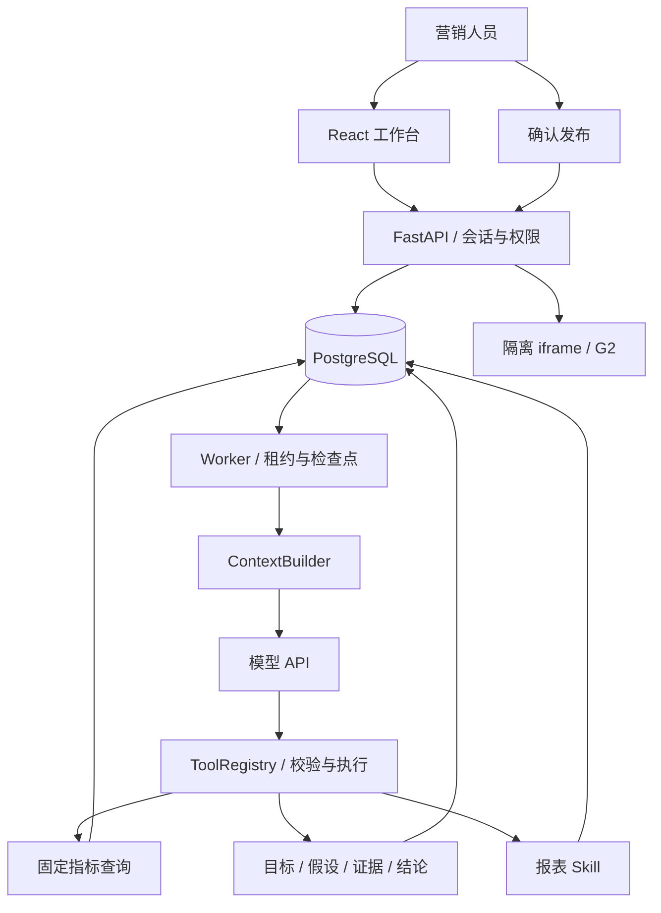

# 架构与设计取舍

## 背景

营销人员需要将数据问题转成可交付报告。直接报表任务关注指标和展示；研究任务需要多次查询、假设修正和证据支持。两条路径共用后端执行保障。

## 模型与程序的边界

模型选择查询维度、筛选、验证步骤和展示形式。程序决定哪些字段和工具有效、谁可以访问、公式如何计算、执行能持续多久，以及发布操作是否来自用户。

本项目不运行模型生成的 SQL、Python 或任意 JavaScript。查询使用 SQLAlchemy 白名单列与绑定参数；页面是受控 HTML 加声明式图表配置。减少可执行代码的自由度，是当前场景为可靠性作出的主动取舍。

## 报告一致性

Goal 固定数据版本。Evidence 保存查询、数据版本、指标版本及完整结果。草稿打开时使用同一版本重新聚合；发布时冻结 Evidence 的结果快照。

布局修改复用原证据。范围变化创建新证据、清空结论引用和旧说明，并明确标记待更新。已发布版本不可被后续草稿覆盖。报表发布 endpoint 对同一版本重复调用返回同一发布结果。

自然语言结论可引用多个证据，图表使用一个主证据。证据 ID 有效不等于结论为真；这一区别保留在评测与界面说明中。

## 沙箱页面

iframe 仅开启 allow-scripts，不开启同源权限。nonce CSP 只允许捆绑的受控渲染脚本，禁止直接联网、表单提交和外部资源。父页面校验消息来源必须是指定 iframe 且 origin 为 null，只接受 report-ready 等固定消息；父页面按已选择版本取数，不接受子页面任意接口地址。

intro_html 仅接受无属性的标题、段落和列表。后端发现清洗结果不同则拒绝保存，而不是静默改变语义。图表资源随构建捆绑，不依赖运行时 CDN。

## 状态和恢复

运行状态为 queued / running / waiting_input / completed / stopped / failed / cancelled。研究完成与报告发布独立。

PostgreSQL 通过 FOR UPDATE SKIP LOCKED 和条件更新领取任务。租约到期后可以再次领取；每个写入事务重新检查 owner，防止旧 Worker 提交。模型调用在事务外执行，后台心跳续租。失去租约的旧调用返回后丢弃结果。

模型响应先持久化 pending，再逐个执行工具。工具业务写入、ToolExecution、事件和 pending 游标在同一事务提交。恢复时继续尚未执行的调用。外部模型调用可能重复计费，系统不宣称整个分布式流程 exactly-once。

读工具参数重复时复用同一 Goal 的证据；指标版本、数据版本、查询共同参与哈希。没有新证据或状态变化且动作重复 3 次才触发无进展停止，不把不同页的证据读取视为同一个动作。

## 上下文和成本

完整模式每轮注入目标、标准、假设、结论、证据摘要和剩余预算，保留最近 3 个完整工具调用包。完整证据按 ID 分页读取。历史模式保留相同系统约束与工具，但依靠预算内的普通聊天记录，不注入研究快照。

输入预算使用 cl100k_base 估算；非同类模型 tokenizer 的结果可能不同，供应商返回的 usage 优先用于统计。每次请求预留输入估算和输出上限；网络错误及进程中断导致无法确认用量时保留预留值，防止恢复后预算归零。

## 不采用的方案

- 不叠加多 Agent：当前业务不需要独立角色并发才能完成。
- 不引入 Redis/Celery：数据库队列足以验证当前规模的任务生命周期。
- 不建设知识库：少量固定规则以版本化文件维护。
- 不自主投放：开放数据不能验证真实执行效果，也没有业务接口。
- SQLite 仅为单 Worker 本地体验和隔离测试；并发正确性另在 PostgreSQL 验证。

## 体验与交付的设计取舍

2026-11-21 的完善集中在同一条业务链：看懂案例 → 提出目标 → 观察执行 → 核对证据 → 修改并交付报告。

| 参考 | 观察到的设计 | 本项目实现与边界 |
|---|---|---|
| [DeerFlow README](https://github.com/bytedance/deer-flow#official-website) | 官方案例提供无需登录的只读展示 | 独立静态案例入口；程序计算的示例明确标注，不假装实时模型执行 |
| [data-agent-arcvis-skill](https://github.com/aliyun/data-agent-skill/blob/main/data-agent-arcvis-skill/SKILL_zh.md) | 表、指标、目标与报告产物关联，模板需要明确数据供给 | 延续原有指标合同；报告返回完整关联证据，引用可下钻，数据同源 |
| [Evidence](https://github.com/evidence-dev/evidence#how-it-works) | 代码化报告与静态发布 | 发布后导出无脚本 HTML 与 CSV，带固定数据和指标版本；不引入整套 BI 运行时 |
| [DB-GPT](https://github.com/eosphoros-ai/DB-GPT) | 数据分析与结果展示的应用流程 | 保留原有数据服务，不扩建连接器市场或多 Agent 平台 |

源码为独立实现，没有复制参考项目代码。参考版本在 references.json。

公开案例只含固定 UCI 哈希的数据，构建器执行三组查询后生成 JSON 与 HTML；不读取 Goal、Run、User、Session 表。GitHub Pages 构建启用 VITE_SHOWCASE_ONLY，进入静态入口，不启动登录、后端或模型请求。案例不是模型自主性的证明，真实调用证据另见评测记录。

真实运行通过 SSE 展示可观察事件，将工具名称翻译为业务步骤；原始字段保留在“技术详情”。每三秒刷新运行快照，使轮次、证据与交付物随执行更新。重连状态不会触发新任务。用户可从结论、假设或查询事件进入证据表，查看样本量与计算口径。

iframe 只发送 evidence ID；宿主页仅从当前已授权载荷中寻找该 ID，不接受任意 URL 或直接执行查询。报告高度消息仅接受有限数值并限制在 420–4000 px。证据弹窗支持键盘关闭、分组搜索与排序，小样本标记与后端一致。

导出路由复用工作区鉴权，拒绝未发布版本；HTML 的标题、结论、参数和表格均转义，不嵌入模型生成的 intro_html，不包含脚本或网络依赖。CSV 防止字符串被表格软件解释为公式。导出使用发布快照；新增导出能力不代表结论已经通过人工业务审核。
