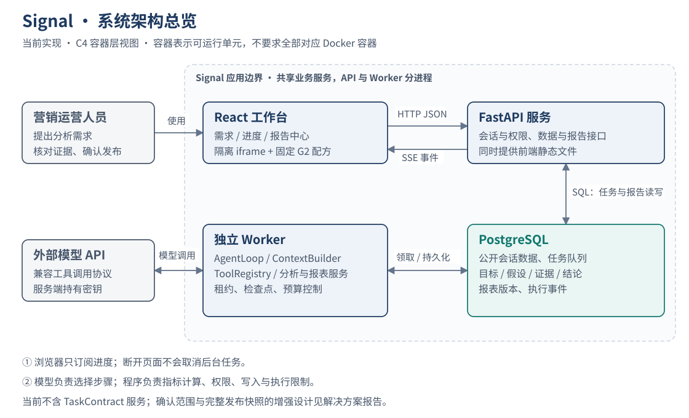
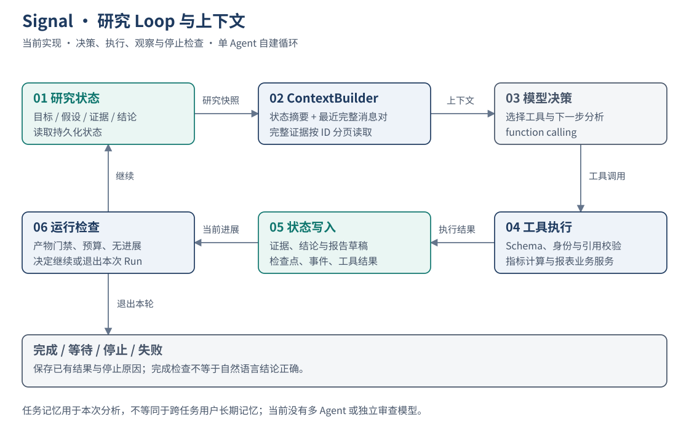
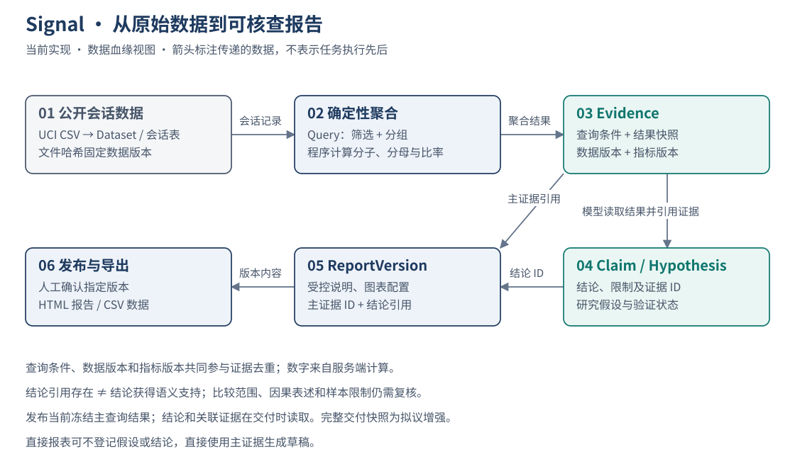
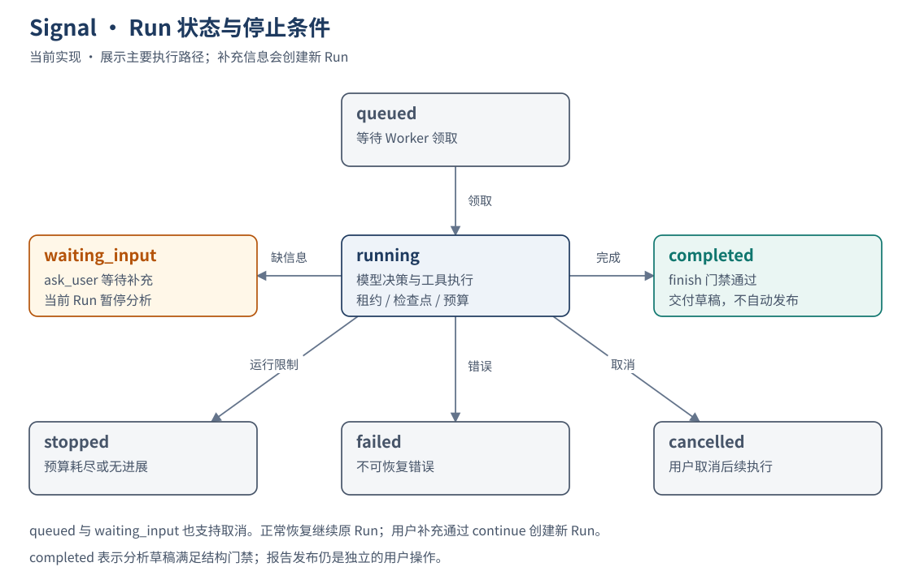
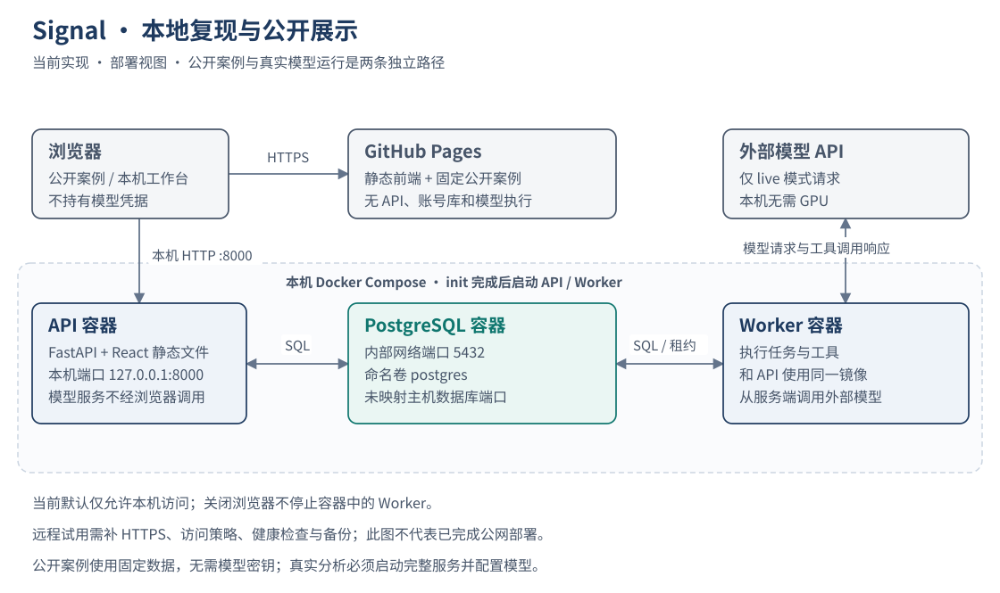

# 当前架构与设计取舍

[项目首页](../README.md) · [文档导航](README.md) · [接口说明](api.md) · [部署运行](operations.md)

**范围：当前本地实现，核对日期 2026-11-24。** 下一阶段的任务合同与完整快照见[目标设计](solution-analysis.md#target-design)，不混入当前架构。

阅读路线：[全局结构](#overview) → [报表 Skill](#report-skill) → [研究 Loop](#research-loop) → [数据与证据](#data-flow) → [执行保障](#reliability)。

## 1. 从业务需求到系统边界

**问题：**直接报表需要稳定交付，复杂分析需要多轮工具调用；浏览器连接不应决定任务是否存活。

**流程：**用户创建 Goal → API 写入 queued Run → Worker 从数据库领取 → 逐轮调用模型与工具 → 保存证据和报告 → 用户确认发布。SSE 只读执行事件，不启动任务。

**取舍：**API 与 Worker 分进程，复用 Python 业务服务；数据库同时存业务状态与队列，减少 POC 基础设施。C4 中的“容器”表示可运行单元，浏览器应用不等同于 Docker 容器。

**验证与边界：**历史 PostgreSQL 并发和恢复记录见[验证文档](validation.md)。当前没有生产规模 SLA，也没有多 Agent、LangGraph 或 Redis/Celery 运行依赖。

| 角色 | 负责什么 | 不能替代什么 |
|---|---|---|
| 模型 | 选择查询、提出假设、解释证据、组织报告 | 程序计算、服务端身份和用户发布确认 |
| 后端程序 | 合同校验、指标计算、权限、状态和幂等 | 不能仅凭结构校验证明分析语义正确 |
| 浏览器 | 工作台、图表、证据核查和用户操作 | 不保存模型密钥、不驱动后台循环 |

## 2. 报表 Skill：从需求到受控页面

**问题：**自由生成图表代码容易出现字段不匹配、渲染失败和指标口径漂移。

**方案与流程：**

1. 报表 Skill 由入口说明、版本化 manifest、模板合同和固定图表配方组成。
2. ContextBuilder 依据任务选择一个模板：分组比较、研究结论或指标概览；指标事实仍由 Pydantic 合同和服务端注册表提供。
3. 模型返回主证据、受约束说明和声明式配置，由 `draft_report` 校验并保存草稿。
4. 浏览器宿主页读取已授权版本载荷，将数据交给隔离 iframe 中的固定 G2 代码。
5. 用户修改形成新版本；人工确认后发布，可导出 HTML / CSV。

**取舍：**当前不执行模型生成的任意 SQL、Python 或 JavaScript。SQLAlchemy 使用白名单列与绑定参数；`intro_html` 只允许无属性的标题、段落和列表，清洗结果不一致时拒绝保存。

**隔离边界：**iframe 仅允许 `allow-scripts`，不开放同源权限；nonce CSP 限制脚本并禁止直接联网。宿主页校验消息源与 `origin=null`，只接受固定消息；证据 ID 只能在当前已授权载荷中查找，不能提交任意 URL。图表资源随前端构建，不依赖运行时 CDN。

**验证：**`scripts/validate_report_skill.py` 检查模板清单；浏览器测试覆盖 G2 渲染、修改、发布与导出。现有报告是一份主查询与固定骨架，不是任意可视化编辑器。

## 3. 研究 Loop：目标、上下文与工具反馈

**问题：**多轮查询只保留对话历史时，目标、已有证据和未验证假设难以稳定组织，历史还会持续增长。

**流程：**每轮注入目标、标准、假设、结论、证据摘要和剩余预算，保留最近三个完整工具调用包；完整结果通过 `read_evidence` 分页读取。模型根据工具反馈决定下一步，程序不固定假设的研究顺序。

**技术边界：**这是基于 function calling 的自建“决策—执行—观察”循环，可以用 ReAct 的交互思想解释，但不展示或持久化为用户可见的私有思维链。研究状态是任务记忆，不是 mem0 式跨任务用户长期记忆。

**取舍：**结构化状态和有限历史便于追溯与恢复，同时增加上下文成本。没有单独模型审查者，也不将更多状态字段等同于更高正确率。

**验证：**full 与 baseline 保持相同模型、工具和约束，对比上下文策略；[历史评测](validation.md)未证明 full 整体更优。完成门禁只检查标准覆盖声明和本次草稿／证据结构，范围和语义仍有改进空间。

## 4. 数据、证据与报告一致性

**问题：**报告数字可渲染不代表计算正确，引用存在也不代表结论成立。

**流程：**Goal 固定数据版本；Evidence 保存查询、结果、数据与指标版本。查询哈希支持同一目标的重复查询复用。Claim 引用证据，ReportVersion 引用主证据与结论。总体转化率由总分子／总分母计算，不平均分组比率。

**版本处理：**布局修改复用证据；筛选范围变化创建新证据，清除旧结论引用与说明，并设置待更新标记。草稿按固定数据版本重新聚合；发布当前冻结主 Evidence 的结果，交付时另读取关联 Claim 与 Evidence。已发布版本不被新草稿覆盖。

**取舍与缺口：**当前不是“完整交付对象全部冻结”。发布函数尚未以 `stale_claims` 拦截发布，也没有合同范围兼容检查；[优化方案](solution-analysis.md#target-design)提出补齐这些能力。用户应先核对适用范围再发布。

**验证：**独立 CSV 核对证明数值计算链路；自然语言结论另按比较范围、因果表达和样本限制进行语义审查。当前公开数据共用，任务与报告按工作区隔离，不声称实现企业私有数据行列权限。

## 5. 任务状态、恢复与预算

**问题：**网络失败、Worker 中断与重复提交不应导致无限循环或重复业务产物。

**运行机制：**

- PostgreSQL 以 `FOR UPDATE SKIP LOCKED` 与条件更新领取；租约过期可重新领取。模型请求在事务外执行，后台心跳续租，写入前检查 owner，丢弃失租后的返回。
- 模型响应先持久化 `pending`，再逐个执行工具；业务写入、ToolExecution、事件和游标在同一事务提交，恢复时继续未执行调用。
- 没有新证据／状态变化且动作重复三次时停止；不同分页的证据读取不视为同一动作。
- Token 用 `cl100k_base` 估算，供应商实际 usage 可得时校正；预留输入和输出预算，用量未知时保留预留值。

**取舍：**避免重复业务写入不等于外部模型请求恰好执行一次；重试可能再次计费。当前每 Run 限额不等于跨续接的 Goal 总预算，后者属于目标设计。

**验证：**故障注入、PostgreSQL 并发领取、过期 owner 和 pending 恢复检查见[评测协议](evaluation.md)。SQLite 仅用于单 Worker 本地体验和隔离测试。

## 6. 部署与运维边界

**流程：**同一镜像运行 API 和 Worker；init 完成迁移与导入；PostgreSQL 使用持久化卷。默认端口只绑定本机，外部模型经服务端访问。在线 Pages 只提供公开固定案例。

**取舍：**先用单机 Compose 降低复现成本；远程试用前补 HTTPS、账号策略、健康检查和备份。当前没有 K8s、高可用或分布式限流实现。

**验证：**按[运行指南](operations.md)启动，按[历史记录](validation.md)区分本地与 CI 的检查环境。执行事件关联任务和工具，可排查失败阶段；不把事件文本当作模型内部思维。

## 7. 参考与具体实现来源

2026-11-21 的完善集中在同一条业务链：看懂案例 → 提出目标 → 观察执行 → 核对证据 → 修改并交付报告。

| 参考 | 观察到的设计 | 本项目实现与边界 |
|---|---|---|
| [DeerFlow README](https://github.com/bytedance/deer-flow#official-website) | 官方案例提供无需登录的只读展示 | 独立静态案例入口；程序计算的示例明确标注，不假装实时模型执行 |
| [data-agent-arcvis-skill](https://github.com/aliyun/data-agent-skill/blob/main/data-agent-arcvis-skill/SKILL_zh.md) | 表、指标、目标与报告产物关联，模板需要明确数据供给 | 延续原有指标合同；报告返回完整关联证据，引用可下钻，数据同源 |
| [Evidence](https://github.com/evidence-dev/evidence#how-it-works) | 代码化报告与静态发布 | 发布后导出无脚本 HTML 与 CSV，带固定数据和指标版本；不引入整套 BI 运行时 |
| [DB-GPT](https://github.com/eosphoros-ai/DB-GPT) | 数据分析与结果展示的应用流程 | 保留原有数据服务，不扩建连接器市场或多 Agent 平台 |

源码为独立实现，没有复制参考项目代码。参考版本在 references.json。

公开案例只含固定 UCI 哈希的数据，构建器执行三组查询后生成 JSON 与 HTML；不读取 Goal、Run、User、Session 表。GitHub Pages 构建启用 VITE_SHOWCASE_ONLY，进入静态入口，不启动登录、后端或模型请求。案例不是模型自主性的证明，真实调用证据另见评测记录。

真实运行通过 SSE 展示可观察事件，将工具名称翻译为业务步骤；原始字段保留在“技术详情”。每三秒刷新运行快照，使轮次、证据与交付物随执行更新。重连状态不会触发新任务。用户可从结论、假设或查询事件进入证据表，查看样本量与计算口径。

iframe 只发送 evidence ID；宿主页仅从当前已授权载荷中寻找该 ID，不接受任意 URL 或直接执行查询。报告高度消息仅接受有限数值并限制在 420–4000 px。证据弹窗支持键盘关闭、分组搜索与排序，小样本标记与后端一致。

导出路由复用工作区鉴权，拒绝未发布版本；HTML 的标题、结论、参数和表格均转义，不嵌入模型生成的 intro_html，不包含脚本或网络依赖。CSV 防止字符串被表格软件解释为公式。导出的主查询数据来自发布快照，关联结论与证据由交付服务读取后写入离线文件；这不同于数据库中冻结完整交付对象。新增导出能力不代表结论已经通过人工业务审核。
