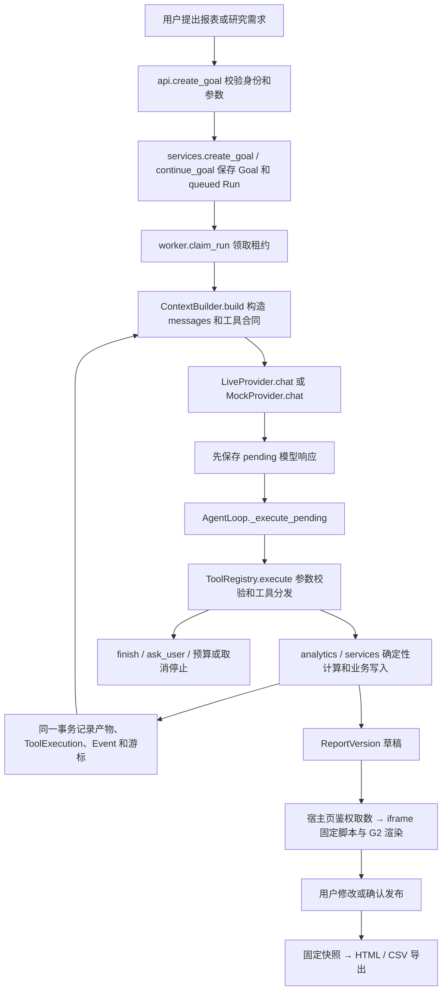

# DeepSeek 学习入口：按实际代码理解 Signal

这份文件是学习导航，不是原公司项目证明。以本仓库当前源码为准，不把规划、参考项目或模型推测当成已实现能力。先读 README，再按下列顺序逐模块学习，无需一次塞入整个仓库。

## 先分清三个入口

| 入口 | 实际发生的事情 | 学习用途 |
|---|---|---|
| GitHub Pages 在线案例 | 加载 web/public/showcase.json；固定公开数据、预先编排的步骤；不调用模型 | 了解交付形态、证据下钻与离线报告 |
| 本地 MODEL_MODE=mock | API、数据库、Worker、工具、报表照常执行，但 MockProvider 用条件分支返回固定工具调用 | 低成本看程序流转；不证明模型自主决策，也不是通用自然语言模拟器 |
| 本地 MODEL_MODE=live | LiveProvider 向服务端配置的模型 API 发送 messages 和 tools，根据返回选择工具 | 观察真实模型决策、错误修正、用量与停止条件 |

本地运行需要 Python、uv、Node；数据首次导入需要访问 UCI，之后数据保存在 data。当前 import-data 即使数据已导入，默认仍会先下载再校验去重；离线时可显式传 `--csv data/<哈希>.csv`。模型使用 API，不需要 GPU。当前 Windows 启动脚本会安装依赖、构建前端；重复启动前先用 stop.ps1 关闭记录的进程，并关闭占用前端构建工具的 Vite 预览服务。

本地 .env 含私密配置，不发给聊天模型。使用 .env.example 讲解字段即可。公开源码包不包含 .env、data 数据库、.venv、node_modules、原始私人材料；运行依赖按锁文件安装，UCI 数据按 README 获取。

## 一张调用图



API 创建任务后不等待整个模型分析；Worker 独立运行。SSE 读取已经保存的事件，不启动任务，不返回私有思维链，也不是模型逐 Token 流式生成。

## 分模块学习，每次只给模型相关文件

| 顺序 | 阅读文件与函数 | 需要解释清楚的问题 | 验证入口 |
|---|---|---|---|
| 1. 数据与合同 | marketing/schemas.py 的 Query / Filters；analytics.py 的 aggregate / collect_evidence / contract | 分子分母为何同范围？如何避免平均百分比？证据为何按查询、数据及指标版本去重？ | tests/test_platform.py 中数值、空数据与非法字段测试 |
| 2. 数据持久化 | models.py、db.py、migrations/versions/ | Goal 与 Run 有何区别？哪些唯一约束防重复？SQLite 与 PostgreSQL 用途有何不同？ | Alembic current；scripts/check_postgres.py |
| 3. 报表 Skill | skills/report/SKILL.md、schemas.ReportSpec、services.clean_spec / make_report / revise_report / publish | 模型究竟生成什么？为什么先预览再发布？从旧版本修改时如何保留正确数据范围？ | 报表版本、幂等与 HTML 校验测试 |
| 4. 工具调用 | tools.py 的 DEFINITIONS / schemas_for / execute；provider.py 的 LiveProvider.chat | JSON Schema 怎样发送给模型？tool_calls 怎样映射 Python 函数？错误怎样返回模型？ | tests/test_failures.py；provider 协议兼容测试 |
| 5. 研究 Loop | context.py、worker.py 的 _process / _execute_pending | 目标和证据如何进入每轮 messages？什么是 pending？谁决定下一步，谁允许停止？ | 上下文配对、预算、取消和恢复测试 |
| 6. 续接与完成 | services.continue_goal；tools.finish 分支；tests/test_continuation.py | 新 Run 与同 Run 恢复的区别？为什么不能拿旧报告直接完成新要求？ | 续接必须交付新草稿；幂等键覆盖完成标准 |
| 7. 前端和证据 | api.py、web/src/main.tsx、RunTimeline.tsx、ReportFrame.tsx、frame.ts、EvidencePanel.tsx | 浏览器何时取数？iframe 为何不能拿登录凭据？结论怎样点回表格？ | web/tests/platform.spec.ts |
| 8. 发布与导出 | delivery.py 的 report_payload / export_html / export_csv；api.export_version | 为什么导出只接受已发布版本？怎样防止越权、脚本注入和 CSV 公式执行？ | tests/test_delivery.py |
| 9. 可靠性与评测 | worker.py、tests/test_failures.py、scripts/evaluate.py、docs/evaluation.md、docs/validation.md | 租约怎样防双写？外部请求是否可能重复计费？数值正确和结论正确有什么区别？ | pytest；已有正式结果，付费评测不要默认重跑 |

不用先背完整文件。每一课先跟踪一个输入的字段如何改变，再理解相关后端知识：Pydantic 校验、HTTP、事务、唯一约束、幂等、锁、租约、SSE、超时、状态机。

## 可以直接交给 DeepSeek 的提示词

```text
你现在是我的代码学习教练。我在学习 Signal 营销分析 Agent，主线只有报表 Skill 和长目标研究 Loop。
先阅读 docs/learning-guide.md、README.md、docs/architecture.md、docs/bad-cases.md。

教学要求：
1. 每次只讲一个模块，最多精读 2–3 个文件。不要一口气概括全部后端。
2. 先说这个模块解决什么问题，再用真实函数名画调用关系，最后逐段讲关键代码。
3. 用“生成 11 月流量转化率报表”跟踪实际字段；举例时标注示例，不能编造日志或实测指标。
4. 每个结论引用仓库路径和函数名；有工具时提供实际行号，没看到文件就请我提供，不要猜。
5. 分清 live 模型决策、mock 固定分支、公开固定案例。不要说 mock 的 if/else 是自主 Agent。
6. 说明模型、Worker、业务服务、数据库和浏览器分别负责什么。
7. 每课补 2–3 个相关基础知识问题，并让我口述一次流程；先纠正我的回答再进入下一课。
8. 对未实现功能明确说未实现；不要把参考项目的架构套进当前仓库。
9. 默认只读讲解；不要改代码、删数据、安装依赖、调用付费 API 或重跑正式评测。
10. 不读取或输出 .env、密钥、会话、数据库内的账号资料。

先讲“数据合同与确定性指标计算”。请先列出你实际看到的文件，再解释 Query → aggregate → collect_evidence。
```

如果使用网页聊天而不是能读本地文件的编码助手：先上传本文件和本课对应源码；打包文件用于传输和备份，不保证每个平台都能直接解压。课程收尾让模型输出一小段“已读文件、已掌握流程、仍不理解的问题”，下次接着学即可。

## 本项目真实能力与容易讲错的地方

- **报表不是任意网页生成。** 模型输出 ReportSpec：标题、受限 intro_html、chart、metric 和 claim_ids。页面骨架及 JavaScript 在 ReportFrame.tsx / frame.ts；目前一份报告绑定一个主查询、一个主图表，配方是 bar / line / table。
- **recipes.json 目前是配方说明。** 运行时约束来自 Pydantic Literal 和 frame.ts 分支，不是动态插件加载器；不要说新增 JSON 就能自动新增图表。
- **修改主要是明确的 UI 操作。** 标题、图表和月份修改走 revise API；自然语言续接交给模型重新分析及生成草稿，不是成熟的自然语言原地编辑器。
- **上下文管理是规则裁剪。** 当前每轮注入结构化快照，取有限数量的状态项和最近三个完整工具调用包；没有语义摘要模型、向量长期记忆或任意旧假设搜索。超过输入预算会停止。
- **完成检查是结构门禁。** 要有本次 Run 成功生成的草稿、标准覆盖，研究还要有至少两份证据、已检查假设和结论。引用存在不等于论证成立，模型仍可能漏掉比较范围或编造年份。
- **UI 模式由用户选择。** report / research 来自用户切换，不是模型自动路由器。模式内下一步工具由 live 模型决定。
- **恢复与续接不同。** 租约恢复继续同一 Run，预算不归零；用户补充信息创建同 Goal 的新 Run，有新运行预算。当前续接使用共享目标状态，不是完整对话历史重放。
- **超时不是强制杀死所有请求。** Worker 在调度边界检查总时长，模型 HTTP 请求有自身超时；取消会停止后续提交，不能保证供应商立刻停止计费。
- **权限是个人工作区隔离。** 没有企业组织邀请、细分角色、SSO、多租户行级业务数据 ACL。默认 UCI 数据是共用公开数据。
- **没有 KB、MCP Server、Redis、Celery 或多 Agent。** 这里通过兼容 Chat Completions 工具协议调用自建 ToolRegistry，不要因为参考了其他项目就声称采用其全部技术。
- **无生产规模证明。** 本项目验证了工程机制、公开数据结果和固定测试；没有真实营销增长、生产客户或大规模并发 SLA 证据。
- **历史评测原样保留。** 早期结果未证明结构化版本整体优于基础版本。结构、数值、语义质量分开看；版本修复后不能把旧模型评测当作新版本重新测出的成绩。

## 不花模型费用的练习

先在独立测试库运行 pytest（测试自动使用临时 SQLite 与 mock，不改你的工作数据库）：

```powershell
uv run pytest -q
uv run pytest tests/test_continuation.py -q
uv run pytest tests/test_delivery.py -q
```

先预测断言，再运行：同一个请求重复提交会怎样？只改标题是否更换证据？改月份为什么移除旧结论？模型不生成新草稿就调用 finish 为什么被拒绝？

浏览器测试需要已经运行的 mock API 与 Worker。已有 live 工作台时，不要直接将其当作低成本测试环境。按 README/CI 配置使用独立测试库和端口；正式模型评测由 scripts/evaluate.py 单独执行，会产生 API 用量。

## 怎样判断自己学会了

不看说明，能够在源码中指出：任务创建入口、后台领取点、模型请求位置、参数校验位置、计算公式、证据写入点、完成门禁、浏览器取数点、人工发布入口和恢复检查点。再用一个真实测试解释为什么这个设计需要存在。
