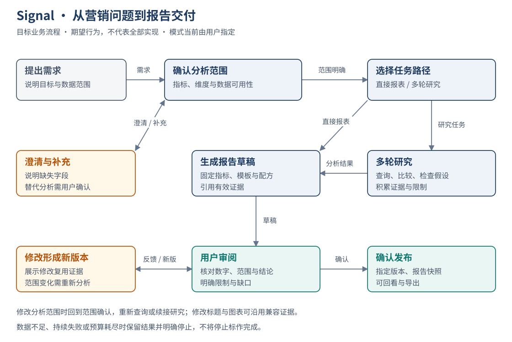
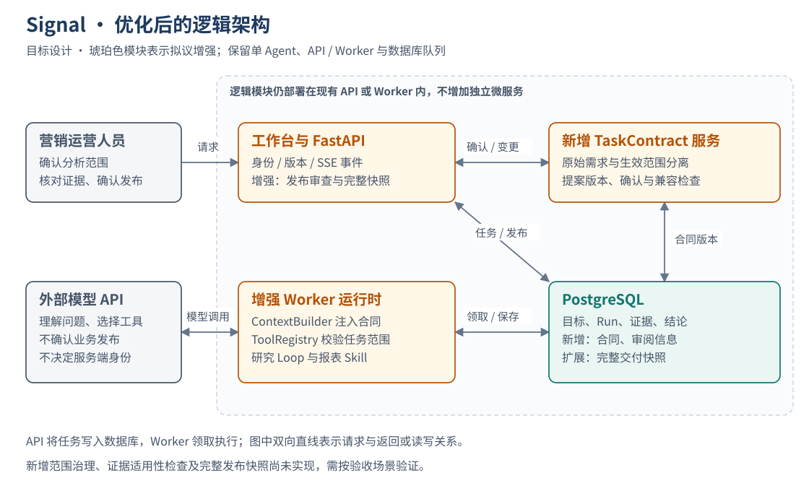
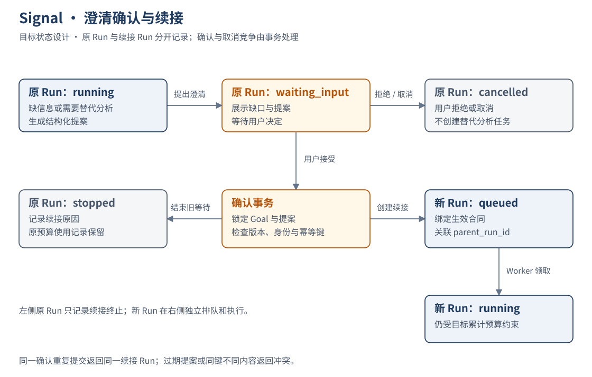
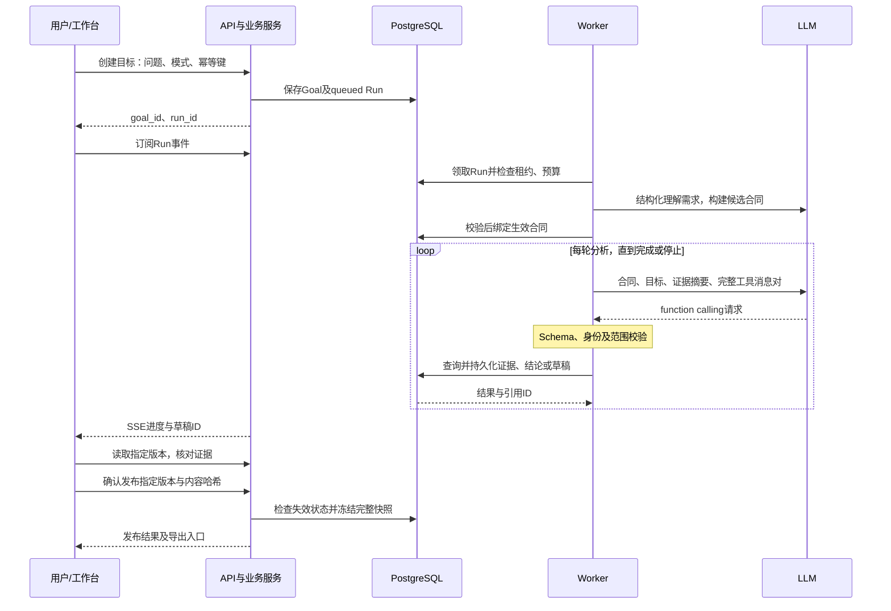
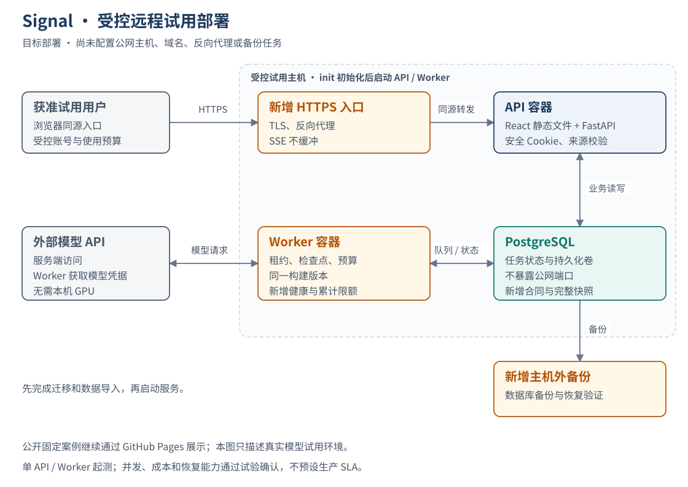

# 营销分析与报告 Agent：场景解决方案报告

[项目首页](../README.md) · [文档导航](README.md) · [当前实现架构](architecture.md) · [验证记录](validation.md)

> **方案摘要：**面向营销运营的转化复盘，使用报表 Skill 将结果交付为网页报告，使用研究 Loop 支持多轮分析。数字由程序计算，结论关联证据，发布由用户确认。

| 方案要点 | 本报告的回答 |
|---|---|
| 服务谁 | 需要比较流量表现、检查访客结构和整理报告的营销运营人员；角色与频率仍待真实访谈验证 |
| 数据与范围 | 公开电商会话数据；购买转化与描述性分析，不补造收入、广告 ROI 或因果效果 |
| 为什么这样设计 | 保留现有单 Agent、自建循环与数据库队列，集中改进范围确认、证据适用性和交付一致性 |
| 如何验收 | 用固定需求、独立数值核算、范围变更、权限和恢复场景验证，不预填业务提升比例 |
| 当前状态 | 原 POC 已有实现与历史记录；本报告的新增 TaskContract、发布门禁和完整快照尚未实现 |

**阅读顺序：**[① 场景与需求](#scenario) → [② 产品对标与取舍](#benchmark) → [③ 优化架构、数据流、接口与部署](#target-design)。

**读图提示：**本报告第三部分展示“目标设计”；当前可运行版本的架构、数据流和部署图统一放在[当前架构文档](architecture.md)，避免将拟议能力当作已实现能力。

---

**报告进度：**已完成场景与需求分析、公开产品对标及优化方案设计；代码改造、POC 复验与交付分析尚未完成。

<a id="scenario"></a>
## 第一部分：场景与需求分析

**版本：**v0.1 · 2026-11-23
**当前交付：**用户与问题定义、现状流程、目标流程、需求优先级、验收标准。
**项目性质：**基于公开电商数据的独立方案设计与 POC 实践，不代表为下述对标厂商实施项目。

### 1. 场景结论

本方案面向电商营销运营人员的**流量与购买转化复盘**：将筛选数据、比较访客结构、核对指标和整理报告串成可复用流程；对需要进一步分析的问题，支持多轮查询、证据积累和结论复核。

核心交付是一份**数字可核算、结论有依据、允许修改并由用户确认发布的报告**。本阶段不以广告自动投放或转化率提升作为交付目标。

典型请求：

> 生成数据集中 11 月各流量类型的购买转化报告；比较低转化流量的新访客与回访者表现，说明样本量、证据及尚不能确定的原因。

这里的“11 月”是数据集的月份类别，不表示当前年份、最近一个月或实时经营情况。实际复盘使用频率需在访谈中确认；POC 不模拟不存在的周级时间字段。

### 2. 依据、假设与证据边界

| 类型 | 本阶段可采用的内容 | 不能据此推导的内容 |
|---|---|---|
| 公开产品事实 | Quick BI 官方描述问数、报告编制与多轮分析；九数云官方描述分析路径拆解、图表生成与可修改报告 | 不能证明特定客户正在使用，也不能证明所有运营团队都有同样痛点 |
| 仓库事实 | 公开会话数据、固定指标、报表与研究两种模式、版本修改、证据记录等已有实现 | 有代码不等于通过本报告的全部验收；历史测试不能当作当前版本新测结果 |
| 场景假设 | 目标运营人员需要反复筛选、分组比较、整理报告；希望减少重复操作并方便复核 | 未访谈确认频率、耗时、采购意愿、用户规模或经济收益 |
| 拟议验收标准 | 下文规定 POC 应表现出的行为及验证办法 | 不是已完成的客户验收或生产 SLA |

公开依据：[Quick BI 智能小Q](https://help.aliyun.com/zh/quick-bi/user-guide/smartq)、[九数云 AI 智能分析](https://help.fanruan.com/jiushuyun/doc-view-1119.html)。这些资料用于确认同类业务场景存在，产品对比与选型详见[第二部分](#benchmark)。

代码核对基线：本地仓库 HEAD 为 `7de960b`，工作区另有未提交修改。本报告基于当日可见实现与已有验证文档，不将工作区状态描述为已发布版本。本次没有运行模型评测或新增实验。

### 3. 用户、使用动机与职责

以下是待真实访谈验证的角色划分，不是已上线的组织权限模型。

| 角色 | 要完成的工作 | 最关心的结果 | 本期参与方式 |
|---|---|---|---|
| 主要用户：营销运营／增长运营 | 查看流量表现、比较访客结构、形成复盘材料 | 不反复找数，能看懂并修改报告 | 提出问题、核对草稿、补充条件、确认发布 |
| 结果审阅者：运营负责人 | 判断哪些差异值得进一步调查 | 分母、口径、证据与分析限制清楚 | 阅读或接收导出报告；不预设多级审批系统 |
| 数据支持人员 | 维护数据字段和指标口径，检查异常 | 计算可复现，问题能定位 | POC 中由开发者承担；企业接入时需明确实际负责人 |
| 实施人员／开发者 | 配置环境、连接模型与数据、处理故障 | 接入边界、日志、停止原因清楚 | 部署和演示，不替业务用户确认结论 |

主要用户故事：

> 当我需要解释不同流量类型的转化表现时，希望系统先给出同口径的数据比较，再按需要检查访客结构，最终交付可核对、可修改的报告，让我将精力放在判断和下一步行动上。

### 4. 当前流程与问题假设

参考流程是对人工分析工作的建模，尚未观测某一真实客户的操作过程。

| 步骤 | 人工工作示例 | 可能出现的问题 | POC 应解决的部分 |
|---|---|---|---|
| 明确范围 | 确定月份、流量类型及转化口径 | “转化率”定义不清，时间范围不明确 | 展示查询范围、指标定义和数据限制；必要时澄清 |
| 准备数据 | 从报表系统或文件取数，过滤并分组 | 重复筛选，分子分母条件不一致 | 复用同一查询合同及确定性计算服务 |
| 比较表现 | 查看各组会话数、购买会话数、转化率 | 只比较百分比，忽略样本量或访客构成 | 同时呈现分子、分母；支持访客类型联合分组 |
| 深入检查 | 发现差异后继续改变维度查询 | 多轮分析容易忘记初始问题、混用旧结论 | 保留目标、待检查问题、查询证据和结论引用 |
| 整理报告 | 将表格、图表和说明搬入汇报材料 | 复制出错，图表与文字范围不一致 | 通过报表 Skill 组织可追溯的交付物 |
| 修改与分发 | 调整标题或月份，再次检查后发送 | 新数据沿用旧结论，版本难以辨认 | 区分展示修改与数据修改，保留版本及发布快照 |

当前痛点不是“缺少一个聊天入口”，而是**取数、分析、解释与交付之间缺少一致的口径和可检查的衔接**。是否值得进一步实施，需要结合实际频率、人工耗时和错误成本验证。

### 5. 数据条件决定的业务范围

默认数据为 [UCI Online Shoppers Purchasing Intention](https://archive.ics.uci.edu/dataset/468/online+shoppers+purchasing+intention+dataset)，12,330 条购物会话。每行是一条会话，不等于一个独立用户或一笔订单。

| 数据与口径 | POC 支持 | 限制 |
|---|---|---|
| 月份、是否周末 | 按已有类别筛选、比较 | 不支持指定年份的自然周、实时趋势、同比；不能由月份推造日期 |
| 流量类型、地区 | 按匿名编码分组 | 不映射成广告平台、具体渠道名称或真实地名 |
| 访客类型 | 比较新访客、回访者与其他类型 | 没有跨会话用户身份，不能计算用户留存、复购或用户级转化 |
| 购买标记 | 统计发生购买的会话 | `Revenue` 是布尔值，没有收入金额或订单数量 |
| 分组查询 | 最多两个维度联合分组 | 不能等同于任意 SQL、任意维度归因或因果分析 |

统一指标：

- **会话数：**满足筛选条件的记录数。
- **购买会话数：**同一筛选范围内，购买标记为真的记录数。
- **购买转化率：**购买会话数 ÷ 会话数；总体值由总分子与总分母计算，不平均各组百分比。
- **空结果：**会话数为零时，转化率为空并说明原因，不以零表示。
- **小样本：**现有计算对少于 30 条会话的组设置提示标记；这是展示提醒，不是统计显著性检验或置信度证明。

因此，当前最合适的价值验证是“转化差异比较与报告交付”，而不是广告 ROI 优化、精确原因诊断或自动制定投放预算。

### 6. 目标流程与人工决策点



这是期望的业务流程，不表示每个节点均已完整实现。当前请求通过 `mode=report/research` 指定模式，不宣称已实现自动意图路由；自然语言续接与表单修改也不等同于完整的自由页面编辑器。

人工决策点包括：确认必要口径、同意替代分析、审核自然语言结论、确认发布。模型可提出分析步骤，但不能代替用户接受业务建议；程序负责计算、校验、权限和状态约束。

当工具持续失败、预算耗尽或分析无进展时，系统应保留可用结果并明确停止原因，不把“停止”包装成“分析完成”。

### 7. 需求优先级

**P0：**构成本期 POC 可交付条件；**P1：**增强体验，可在核心链路之后完善；**不纳入：**当前数据或项目范围不支持。

| ID | 优先级 | 用户需求与交付要求 | 当前依据与待确认点 |
|---|---|---|---|
| R01 | P0 | 明确分析范围及指标；不支持的请求说明缺失信息 | 已有查询合同与限制说明；自然语言缺数据处理仍有已知缺口 |
| R02 | P0 | 同口径计算会话数、购买会话数和转化率，支持单维及双维比较 | 已有计算实现；验收需与独立计算逐项核对 |
| R03 | P0 | 生成能打开、能看图表和口径的报告草稿 | 已有报表 Skill；首版限定模板与图表配方，不承诺任意布局 |
| R04 | P0 | 根据研究问题继续查询，保存目标与证据，形成有依据的有限结论 | 已有研究状态与工具循环；结构完整不等于语义结论正确 |
| R05 | P0 | 从结论查看原查询、样本量、结果和版本 | 已有证据关联及查看入口；需核对引用是否真正支持结论 |
| R06 | P0 | 修改产生新版本；改数据范围时不沿用失效结论；人工确认发布 | 已有版本服务；范围改变后清除旧结论并提示续接，不承诺自动重写所有结论 |
| R07 | P0 | 他人不能越权访问；失败、重试和重启不导致重复产物或无限执行 | 已有工作区及后台任务机制；不等同于企业组织权限或生产容灾 |
| R08 | P0 | 保留发布时的数据快照，导出可独立阅读的报告 | 已有 HTML／CSV 导出；需验证导出数字及证据与发布版一致 |
| R09 | P1 | 提供清楚的执行进展、失败原因和无需配置的体验入口 | 已有事件与公开固定案例；固定案例不能证明模型自主分析 |
| R10 | P1 | 复用典型问题与报告样式，减少输入和修改成本 | 已有示例提示及受控模板；业务人员是否易用尚未验证 |
| R11 | 不纳入 | 广告投放执行、ROI、用户留存、实时周报、自动证明因果 | 缺数据或缺执行接口，不能用模型补造 |
| R12 | 不纳入 | 企业 SSO、多级审批、多租户生产 SLA、任意数据源接入 | 可列后续接入需求，不作为本期已有能力 |

### 8. POC 验收场景与判定方式

以下是为后续验证制定的验收合同，**本次未重新执行**。测试清单应固定输入、数据版本、预期行为及失败判定；有失败就保留，不仅挑选演示成功案例。

| 验收 ID／需求 | 输入或操作 | 通过条件 | 判定方法 |
|---|---|---|---|
| A01／R01–R03 | “按数据集 11 月、流量类型生成购买转化报表” | 月份和分组正确；展示三项指标；图表可渲染；产物为草稿 | 使用独立 CSV 计算核对每组整数计数；比率按约定精度核对；浏览器检查 |
| A02／R04–R05 | 比较流量转化，再检查新访客与回访者差异 | 有实际联合分组证据；说明样本量；结论引用可打开；不把关联写成已证实的原因 | 检查真实模型工具轨迹、数据表及逐条人工语义复核；不同任务可有不同分析顺序 |
| A03／R01–R02 | 使用预先核实为空结果的合法筛选组合 | 显示无数据；转化率为空；不编造趋势或业务解释 | 独立数据检查＋接口与页面断言 |
| A04／R01 | “计算本周各广告平台 ROI” | 说明日期、渠道映射、成本及收入字段不足；如给出替代方案，等待用户确认后再执行替代任务 | 检查回复、状态和后续调用；不得将转化报表视为原 ROI 任务完成 |
| A05／R06 | 先改标题，再将 11 月改为其他有数据月份 | 标题修改不改变原数据范围；月份修改生成新证据和新版本，旧结论清除并提示更新；历史版本可回看 | 比较前后查询、证据、结论引用与版本记录 |
| A06／R06、R08 | 用户发布并重复提交同一确认，再导出 HTML／CSV | 模型不能自行发布；重复确认不重复产生发布结果；导出值与快照一致，HTML 可离线阅读 | API 权限与幂等检查、数据库记录、离线浏览和数值核对 |
| A07／R07 | 用另一工作区访问报告与证据 | 无法获得正文、数据或导出结果 | 两个隔离测试身份进行对象访问检查 |
| A08／R07、R09 | 注入工具失败、关闭浏览器、重启 Worker、触发预算限制 | 展示可理解的状态；任务能够恢复或明确停止；已有结果可定位；无重复产物或无限重试 | 故障测试与持久化记录；逐种故障单独判定，不将 mock 当作模型能力验证 |

验收原则：固定场景中的数值错误、越权、重复发布、失效结论沿用，以及把不支持的需求伪装成完成，均应作为阻断问题处理。研究结论由人工逐条复核，模型评审只能辅助；仅有引用 ID 不算证据支持成立。

响应时间、并发量、Token 成本记录实测值与环境，不在未获需求依据时承诺“秒级响应”或特定 QPS。现有超时和预算是运行保护参数，不是服务等级承诺。

### 9. 如何验证业务价值

本期先验证“交付是否正确、过程是否可检查”，再验证“是否减少用户工作量”。不预填提效比例、用户满意度或转化提升。

| 维度 | 记录方法 | 当前状态 |
|---|---|---|
| 完成质量 | 按 A01–A08 记录通过、失败、停止及原因；区分工程测试与真实模型任务 | 有历史测试可参考，尚未按本报告重新验收 |
| 人工投入 | 对同一任务分别记录人工工具流程与 Agent 辅助流程的实际操作时间、等待时间和修改次数 | 未测；需先确定操作者、熟练度及任务难度 |
| 结果可复核性 | 记录审阅者是否能独立找出查询范围、样本量和结论依据，以及发现的错误 | 未开展真实业务用户审阅 |
| 运行代价 | 记录端到端时延、Token、失败重试；只有单价可信时换算费用 | 保留历史记录，但不代表业务 ROI |

对照时两种流程使用相同数据、口径和交付要求，均从需求理解计时至可审阅产物完成，并保留失败与返工。具体执行方案在 POC 验证阶段制定。

### 10. 后续访谈需要确认的问题

1. 谁实际制作和审核报告？是固定复盘还是临时分析，频率如何？
2. 当前从哪些系统取数？能否提供一份可公开或脱敏的现有报告及制作流程？
3. “转化”的业务定义是什么？统计单位是用户、会话还是订单？时间范围如何确定？
4. 哪一步最耗人工时间，哪些错误最常见？能否观察一次实际任务并记录，而不是仅估计？
5. 哪些结论需要人工核对？什么情况下必须询问、停止或交给数据人员？
6. 需要哪些数据权限、部署方式、报告格式及共享渠道？对等待时间和费用的可接受范围是什么？

访谈答案用于修订本报告的角色、优先级和验收条件；当前没有客户确认记录，不虚构访谈引用。

### 11. 本阶段交付与下一阶段输入

已形成一个可验证的场景范围：**公开购物会话数据 → 转化比较与访客结构检查 → 有证据的报告草稿 → 人工修改与发布**，并列出 12 项需求、8 个验收场景和待验证的业务假设。

下一阶段产品调研仅围绕这组需求比较：问题澄清、指标口径、分析下钻、报告修改、证据复核和权限交付。只有能够解释某项需求如何被解决的产品能力，才进入对比表；不以功能数量决定方案优劣。

### 本地事实索引

- [项目说明](../README.md)：数据来源、试用流程与当前边界。
- [查询与报表 Schema](../marketing/schemas.py)：五种维度、双维查询、报表配方和模式参数。
- [指标与聚合计算](../marketing/analytics.py)：指标公式、空结果、小样本与证据结果。
- [报告与版本服务](../marketing/services.py)：修改范围后清除结论、发布快照及访问范围检查。
- [历史验证记录](validation.md)：已有测试与未解决问题；尤其是缺数据请求、语义正确性和评测版本限制。

以上路径用于说明需求与已有实现的关系。需求由场景推导，代码只用于核实当前能力，不能代替用户验证。

<a id="benchmark"></a>
## 第二部分：产品对标与设计取舍

**调研日期：**2026-11-23。
**研究问题：**神策、帆软、阿里云与火山引擎如何连接“提出业务问题—分析—生成报告—复核交付”？本项目应吸收哪些做法，又应保留哪些范围边界？
**方法：**阅读官方产品页和操作文档，按第一部分 R01–R10 对照；未登录试用这些商业产品，未执行统一任务测试，未访谈厂商或客户。以下是文档调研，不是性能或准确率测评。

### 1. 对标对象与选择原因

| 对象 | 本次具体研究范围 | 与本项目的关系 |
|---|---|---|
| 神策数据 Sensors AI | 官方公布的主 Agent、深度分析、智能报告与 Skills 体系 | 观察如何从运营目标组织分析任务，而不只是提供单个查数功能。[S1][s1] |
| 帆软九数云 AI 智能分析 | 分析 Agent、场景 Agent、计划／对话模式及 BI 资产管理 | 观察探索分析如何成为可复用、可编辑的分析成果；不将 FineReport、FineBI 或其他帆软产品能力混入本次结论。[S2][s2] [S3][s3] |
| 阿里云 Quick BI | 智能小Q的问数、解读、报告及 Skill；另核对 AIPro Skill 的集成边界 | 既看报告生命周期，也看能力如何供其他 Agent 调用；不同 Skill 的文件与数据准备限制分别记录。[S4][s4] [S5][s5] [S6][s6] [S8][s8] [S9][s9] |
| 火山引擎 Data Agent | 以智能分析 Agent 为主要对标，公域洞察助手为营销研究的补充对照 | 问数与深度研究接近本项目两条路径；公域洞察用于分析数据依赖的差异，不把其外部数据能力视为本项目已有能力。[S10][s10] [S11][s11] [S12][s12] |

**厂商与产品层级：**Quick BI 已属于阿里云，不再另计一家厂商；本报告共对标四家厂商。火山的智能分析与智能营销是不同模块，能力不互相默认继承。通用 Agent 搭建平台不作为本轮新的比较对象，以保持营销分析主线集中。

阅读限制：神策来源主要是产品架构介绍，证据粒度偏概述；九数云所查文档仍标注 AI 功能内测；Quick BI 概述将相关 Agent 列为受版本、购买与席位配置影响的增值能力；火山文档说明深度研究需要搭配数据查询 Agent，购买与部署条件需单独确认。不能按“官网写了多少功能”直接排名。[S1][s1] [S2][s2] [S4][s4] [S11][s11]

### 2. 同类业务问题的处理方式

下表记录**官方描述**，每项附来源。“待核实”表示本次资料不足以判断，不表示厂商没有该能力。

| 需求／比较维度 | 神策 Sensors AI | 帆软九数云 | Quick BI 智能小Q |
|---|---|---|---|
| R01：从业务问题开始 | 主 Agent 承担理解、拆解与调度。[S1][s1] | 计划模式先对齐口径与步骤，由用户确认后执行；另有即时对话方式。[S2][s2] | 用户选择数据集进行自然语言问数；报告另有生成与编辑入口。[S4][s4] |
| R02：口径与数据基础 | 能力建立在神策分析、标签等业务数据底座之上；精确字段映射规则需进一步核实。[S1][s1] | AI 与 BI 复用数据连接、指标、语义口径及计算资产。[S3][s3] | 可把已有仪表板图表、问数及解读结果加入报告，减少重新制作。[S7][s7] |
| R04：多轮研究 | 深度分析承担路径规划和结论组织，主 Agent 负责上下文与结果整合。[S1][s1] | 支持基于上一步结果继续追问下钻。[S2][s2] | 问数支持多轮交互与异常下钻，报告可结合分析结果组织内容。[S4][s4] |
| R03、R10：报告与方法复用 | 智能报告面向结构化、可复用的周期报告。[S1][s1] | 分析成果可转为故事板或仪表板，稳定分析思路可沉淀为技能。[S2][s2] | 报告可编辑文字、样式和布局；分析素材可从已有组件引入。[S5][s5] [S7][s7] |
| R05：复核来源与过程 | 官方声明提供引用溯源及过程治理；引用粒度和用户操作仍需试用。[S1][s1] | 文档说明可查看数据来源、分析路径与关键口径。[S3][s3] | 有引用资源面板；智能生成的报告可查看创建过程。资源可见不自动等于逐条结论均被证明。[S5][s5] |
| R06、R08：更新与交付 | 本次概述未充分说明报告修改、冻结快照和导出规则，待核实 | 可编辑、保存和导出分析成果；所查文档未说明是否按本项目方式冻结发布版本。[S2][s2] [S3][s3] | 支持预览、发布、分享及数据更新；刷新后要求重新确认内容，区分局部和全量更新。[S6][s6] |
| R07：权限与人工控制 | 声明权限控制与关键操作确认。[S1][s1] | 复用 BI 权限体系。[S3][s3] | 报告可授权查看、导出和编辑；刷新时检查相关数据查询权限。[S6][s6] |
| 缺数据、错误恢复与准确性 | 本次未取得可比的统一任务结果 | 本次未取得可比的统一任务结果 | 本次未取得可比的统一任务结果 |

#### 阿里云开放能力与火山引擎补充对照

为避免主表过宽，新增能力沿用相同需求编号单独列出。阿里云本表补充其对外集成方式，不重复计算上表的 Quick BI 报告能力。

| 需求／比较维度 | 阿里云 Quick BI 开放能力 | 火山引擎 Data Agent | 本项目应如何理解 |
|---|---|---|---|
| R01、R04：入口与分析路径 | 智能小Q Skill 可调用问数、报表、解读和报告能力；AIPro Skill 面向自有或第三方 Agent 集成。[S8][s8] [S9][s9] | 智能分析区分问数与深度研究：前者支持多轮查询，后者规划框架并输出研究报告。[S10][s10] | 简单报表与研究任务可以共享后端能力，但不代表必须拆成多个 Agent |
| R02：数据与计算 | AIPro Skill 使用预先准备的数据资产、指标及业务知识；其文档明确不承担上传文件、建数据集和配置数据源等准备工作。[S8][s8] | 智能分析支持数据连接与建模；深度研究文档描述通过生成 SQL/Python 分析数据。[S10][s10] | 数据准备、指标计算和模型规划分工清楚；本项目的受约束查询 API 是更窄的选择 |
| R03、R08：产物与集成 | 小Q报告 Skill 调用开放 API，完成后提供报告链接；AIPro Skill 可返回文本、表格及报告等产物。[S8][s8] [S9][s9] | 智能分析输出研究报告；公域洞察面向消费者、营销策略及市场趋势研究。[S10][s10] [S12][s12] | 输出应是可定位、可读取的产物，而不只是聊天里显示“已完成” |
| R07：会话、任务与身份 | AIPro Skill 描述会话管理、任务状态查询及取消，并按映射的用户身份验证权限。[S8][s8] | 所查智能分析概述列出云上与本地模型适配；具体任务恢复、细粒度权限及发布确认需进一步核实。[S10][s10] | 可借鉴任务状态和身份传播；不能因模型部署在本地就认为权限问题已经解决 |
| 数据范围与依赖 | 小Q Skill 的本地文件分析与 AIPro Skill 的既有资产调用不可混为同一种接入约束。[S8][s8] [S9][s9] | 公域洞察官方列出画像、社媒、电商等数据，业务覆盖依赖相应数据来源和授权。[S12][s12] | 当前 UCI 数据只能验证会话转化分析，无法据此宣称具备品牌舆情、竞品或人群画像研究能力 |
| R05、R06：证据与版本 | 报告引用、刷新及权限行为仍按上表具体 Quick BI 文档核对 | 本次概述不足以确认结论级证据绑定、固定发布快照和用户改稿行为 | 不由“支持研究报告”推断完整交付能力；试用时单独验收 |

**调研判断：**四家均强调数据或业务基础与分析能力的结合；对本项目最有价值的是这种衔接方式。产品页中的“归因”“深度分析”不应直接解释为统计因果识别，也不能据此认定能解决任意开放问题。

### 3. 在统一场景下理解四家方案

统一需求沿用第一部分：“比较数据集 11 月流量转化，进一步检查访客结构，并形成供人复核的报告。”下面是根据文档映射出的使用路径，**不是实际试用记录**；各产品能否无损接入同一份 UCI 数据与统一口径，尚未验证。

- **神策路径的启示：**以运营问题组织任务，将分析和报告看作两个有联系的业务环节。对本项目而言，研究 Loop 的产物应能交给报表 Skill，而不让模型在生成页面时重新猜测结论。这是本报告的设计推论，不代表神策采用相同内部对象模型。
- **九数云路径的启示：**先对齐分析范围，再探索和沉淀方法。对本项目而言，用户只要一个明确报表时无需复杂规划；问题存在歧义或需要替代分析时，应先澄清，而不是盲目继续调用工具。
- **Quick BI 路径的启示：**分析结果进入报告后仍需要修改、更新和权限管理。对本项目而言，“页面生成成功”只是中间状态，用户还要确认数据范围、结论依据和最终版本。
- **阿里云开放集成的启示：**报告能力可以由既有平台提供，再通过 Skill 接到用户工作入口。本项目应区分“定义流程和约束的 Skill”与“实际执行任务的服务”；未来集成商业后端时，保留任务、身份和产物合同，不需要重新做全部 UI。
- **火山引擎路径的启示：**问数与深度研究的业务分工，与本项目两条主线具有可比性。但当前优先复用统一查询 API，不扩展到任意 SQL/Python 执行；公域营销研究也应等到有真实数据来源后再考虑。

以上推论对应前表来源；只借鉴业务机制，不推定厂商的状态机、提示词、数据库、Agent 框架或实际重试实现。

### 4. 设计取舍记录

以下是**本项目的判断与拟议选择**。其中“保留”表示现有实现与调研结论一致，不倒写成开发时已经参考了本次资料；“补齐”仍是建议，本阶段未修改代码。

| 决策 | 备选方案 | 本项目选择、理由与代价 | 状态／验收关联 |
|---|---|---|---|
| D01：任务组织 | 完整多 Agent；单 Agent 加业务工具与 Skill | **保留单 Agent＋报表 Skill＋研究 Loop。**目前任务围绕同一数据集和少量指标，尚无独立专家分支的效果证据；减少跨 Agent 口径同步和恢复复杂度。代价是暂不提供并行专家分工。参考神策的能力分层思想，不照搬 Agent 数量。 | 保留；R03–R04／A01–A02 |
| D02：执行前确认 | 每次都确认完整计划；完全自主执行；仅在必要时澄清 | **补齐按需澄清。**明确且支持的报表直接执行；指标歧义、缺必要字段或变更目标时，先确认。优先处理 ROI 请求被自行替换的已有缺口。代价是这些任务多一次交互；不为所有只读查询增加审批。 | 建议优先补齐；R01／A04 |
| D03：指标计算 | 模型计算；任意生成 SQL；受约束聚合 API | **保留确定性计算与统一合同。**当前三项指标和五种维度能覆盖本期任务，程序控制分子、分母与筛选。代价是表达范围窄；新增指标必须更新合同和核验用例。 | 保留；R02／A01、A03 |
| D04：报告呈现 | 任意 HTML/JS；完整富文本 BI 编辑器；受控模板 | **保留受控模板与图表配方。**本期优先可靠渲染及修改，不建设通用编辑平台。保留标题、图表及查询范围等修改入口；代价是布局自由度低。Quick BI 的丰富编辑能力作为未来需求参照，不等于当前要全部实现。 | 保留；R03、R06／A01、A05 |
| D05：数据更新 | 原页面直接换成最新值；每次重做全部内容；版本化更新 | **保留发布快照与范围变更后的结论失效处理。**样式调整沿用证据，数据条件变化重新查询并提示更新结论。代价是需要管理版本和续接状态；不是自动保证新结论正确。 | 保留并复验；R06、R08／A05–A06 |
| D06：证据呈现 | 只给总结；仅保存日志；结论关联可查看证据 | **保留结论到查询结果的关联。**让审阅者看到范围、分子分母和版本，并检查支持关系。代价是额外数据与交互设计；结构可追溯和语义正确必须分开验收。 | 保留并加强复核；R05／A02 |
| D07：方法沉淀 | 全量照搬营销平台技能；自动保存所有分析为 Skill；人工维护版本化 Skill | **保留一个报表 Skill 和少量规范。**只有在多个独立任务中验证稳定的分析方法才考虑新增技能。代价是覆盖面有限；不增加知识库管理、多 Agent 或十几个占位 Skill。 | 保留；R10 |
| D08：共享与权限 | 完整组织权限；无鉴权公开业务数据；个人工作区＋受控导出 | **保留工作区隔离与人工发布。**本期公开展示仅使用公开数据，企业行列权限、组织协作另行设计。代价是不能直接接入多人生产场景；下载后的静态文件不能被服务端撤回或继续鉴权。 | 保留边界；R07–R08／A06–A07 |
| D09：能力对外集成 | 独立平台；直接调用厂商 API；通过 Skill 接入外部工作台 | **本期保留独立可复现运行，预留服务与入口分离。**借鉴阿里云 Skill 对任务与产物的封装；当前不接入付费厂商 API，也不把一个 Skill 文件当成完整运行时。代价是暂不覆盖第三方工作台集成。 | 范围取舍；R03、R07–R08 |
| D10：开放计算与公域研究 | 模型生成 SQL/Python；引入外部画像、社媒数据；继续限定查询合同 | **本期继续限定查询。**火山智能分析与公域洞察分别提示了更广计算和数据能力，但它们需要额外执行隔离、权限、数据授权和质量验证。当前任务没有证明这种复杂度必要。代价是研究范围受固定指标和维度约束。 | 保留边界；R01–R02、R11 |

这些选择说明“为什么在当前范围内这样实现”，不构成相对商业产品的领先性结论。后续只有需求或实测证据变化，才调整范围。

### 5. 两个需要专门讲清的技术区别

**对话记录、研究状态与长期记忆不同。**连续追问体现上下文衔接，但不能仅据产品文案推定底层记忆机制。本项目的 Goal、Hypothesis、Evidence、Claim 用于同一目标的进度与证据管理；它不等于用户画像记忆、跨任务经验学习或 mem0 集成。已有状态管理应以续接和复核表现证明价值，而非仅用“长期记忆”命名。

**动态报告与发布快照不同。**Quick BI 文档描述动态资源可以刷新，也可在启用数据权限后根据查看者权限重新取数。[S5][s5] 本项目选择用户审阅后的固定快照作为导出依据，重点保证“看到的结论对应哪一批数据”。如果未来接入实时数据，应另行定义刷新、重新审核、内容失效及导出权限，不能简单自动刷新图表而保留旧解释。

### 6. 自研、采购还是集成：解决方案工程师的判断

这次调研不支持“所有客户都应使用本项目”。针对真实客户，应先判断已有基础和交付成本：

| 客户条件（假设） | 建议优先验证的路径 | 需要补充的信息 |
|---|---|---|
| 已有神策数据体系，需求同时涉及分析、客群和运营策略 | 验证原平台能力与扩展接口，避免重新建设数据底座 | 数据可用范围、分析准确性、授权和产品版本 |
| 已有帆软数据资产及统一指标，需求集中在内部 BI 分析 | 验证其 AI 能力能否复用既有数据与口径 | 内测／商业可用状态、部署条件、权限继承和导出行为 |
| 已有 Quick BI，核心困难是报告编制、更新与协作 | 先验证报告相关模块，再比较二次开发与独立建设 | 增值模块费用、席位、资源权限、更新方式和接口限制 |
| 已有自有 Agent 工作入口与 Quick BI 数据资产 | 验证 Skill／开放 API 集成，避免重复建设报告后端 | 具体 Skill 适用版本、身份映射、数据准备边界与任务接口 |
| 希望接入企业数据做问数与深度研究，或另有公域营销洞察需求 | 分别验证火山智能分析与公域洞察模块，不默认两者使用同一数据或购买包 | 数据查询与研究的依赖关系、可用数据授权、模型部署方式、结果复核及费用 |
| 尚无上述平台，只需要有限数据集和固定分析任务的 POC | 本项目可作为小范围验证工具，再评估后续采购或集成 | 数据接入成本、维护者、真实用户验收与信息安全要求 |

这是依据产品定位作出的条件化建议，不是采购结论。本次没有报价与总拥有成本数据，不能断言自研更便宜；开源代码也不意味着模型、部署和运维免费。

### 7. 本轮发现的优先补齐项

本节是下一阶段输入，**不是本轮已实现功能**。

1. **先解决缺数据时擅自改题的问题。**将原目标、缺失字段、建议替代任务和用户确认分开记录；在用户同意之前，不把其他报表作为原任务已完成的依据。对应 D02、A04。
2. **让分析范围始终可见。**在草稿和证据入口统一显示数据版本、筛选条件、指标口径及未解决问题；范围变化时明确指出哪些结论失效。已有能力先复验，再决定是否补 UI。对应 D03、D05、A01、A05。
3. **把证据支持检查放入交付验收。**重点检查总体与分组是否混淆、月份是否被误写成当前年份，以及描述性差异是否被写成原因。引用存在但不支持结论，同样应判失败。对应 D06、A02。

暂缓完整 BI 编辑器、组织协同系统、长期用户记忆、多 Agent 和更多 Skill；只有后续真实需求证明其必要性才扩展。这与保留报表 Skill 和研究 Loop 两条主线一致。

### 8. 资料索引与待验证事项

所有来源于 2026-11-23 查阅；优先引用官方正文，不使用搜索摘要中的性能宣传作为实测证据。部分页面没有可可靠提取的更新时间，使用查阅日期标记，不推断其产品发布时间。

| 来源 | 官方页面与定位 | 本报告用途 |
|---|---|---|
| S1 | [Sensors AI 产品页][s1]：“主 Agent 为中枢的分层能力体系”“整体技术架构” | 目标调度、分析与报告分工、官方治理主张 |
| S2 | [九数云 AI 智能分析][s2]：“选择分析方式”“沉淀分析思路到技能”“分享、导出和保存” | 计划确认、连续分析、Skill 与成果复用；页面标注内测 |
| S3 | [九数云 AI 智能分析介绍][s3]：“概述”“产品特点” | 共用 BI 资产、口径、权限及来源查看；页面标注内测 |
| S4 | [Quick BI 智能小Q概述][s4]：“重要”“功能简介” | 能力入口与增值模块边界 |
| S5 | [Quick BI 文档编辑][s5]：“引用资源”“查看创建过程” | 可编辑报告、引用来源、动态资源与创建过程 |
| S6 | [Quick BI 小Q报告管理][s6]：“更新数据”“预览”“协同授权”等 | 数据更新后复核、发布分享与权限条件 |
| S7 | [已有内容添加至小Q报告][s7]：“前提条件”“使用限制”及组件插入说明 | 重用既有分析素材，避免重复生成 |
| S8 | [Quick BI AIPro Skill 操作手册][s8]：“核心能力”“使用限制”“前置准备” | 外部 Agent 集成、会话与任务、用户身份及数据准备边界 |
| S9 | [智能小Q Skill 操作手册][s9]：“核心技能”“技能使用说明” | 问数与报告开放 API、文件分析与报告链接；不与 AIPro 限制混用 |
| S10 | [火山智能分析 Agent 概述][s10]：“智能分析”“模型对接”“数据准备” | 问数／深度研究分工、SQL/Python 分析、数据与模型接入 |
| S11 | [什么是数据智能体 Data Agent][s11]：“产品架构” | 模块划分、深度研究与数据查询的购买依赖 |
| S12 | [火山公域洞察助手概述][s12]：“产品介绍”及数据说明 | 消费者与市场研究场景、数据依赖；不采纳未经核验的优越性宣传 |

如果后续能获得试用环境，优先核实同一任务的实际交互、字段口径配置、缺数据响应、权限变化后的可见性，以及报告刷新时文字与数字的一致性。开放集成另需检查任务状态、取消和身份传播；公域研究另需核实数据授权与来源覆盖。未经试用，不给这些产品准确率、耗时、稳定性或价格打分。

**本阶段形成的取舍：**采用平台化治理和可复核交付的思路，继续以单 Agent、受控报表 Skill 与有状态研究 Loop 承载有限业务范围。下一阶段据此细化数据合同、确认状态和报告交付边界，不扩大为完整营销平台复刻。

[s1]: https://www.sensorsdata.cn/engines/SensorsAI.html
[s2]: https://help.fanruan.com/jiushuyun/doc-view-1115.html
[s3]: https://help.fanruan.com/jiushuyun/doc-view-1119.html
[s4]: https://help.aliyun.com/zh/quick-bi/user-guide/smartq
[s5]: https://help.aliyun.com/zh/quick-bi/user-guide/document-editing
[s6]: https://help.aliyun.com/zh/quick-bi/user-guide/intelligent-data-reporting-management
[s7]: https://help.aliyun.com/zh/quick-bi/user-guide/add-intelligent-data-report-material
[s8]: https://help.aliyun.com/zh/quick-bi/user-guide/aipro-skill
[s9]: https://help.aliyun.com/zh/quick-bi/user-guide/quick-bi-open-skill-manual
[s10]: https://docs.volcengine.com/docs/data-agent/overview-of-intelligent-analytics-agent?lang=zh
[s11]: https://docs.volcengine.com/docs/data-agent/what-is-a-data-agent?lang=zh
[s12]: https://docs.volcengine.com/docs/data-agent/overview-of-public-domain-insight-assistant?lang=zh

<a id="target-design"></a>
## 第三部分：优化后的技术方案

**设计日期：**2026-11-23。
**状态：**设计稿，尚未改造或部署。现有能力依据当日本地代码核对；“新增”“增强”均不代表已实现。
**方案目标：**在保持报表 Skill 与研究 Loop 的前提下，把任务边界、证据范围和发布结果连接起来，形成可运行、可解释、可验收的 POC。

### 1. 优化范围与现状差距

保留 Python／FastAPI、Pydantic、SQLAlchemy、PostgreSQL、独立 Worker、React、受控 G2 配方及 Docker Compose。当前规模没有证据要求迁移 LangGraph、拆微服务、增加 Redis 或引入多 Agent。

| 优化点 | 当前代码中的情况 | 目标行为 | 对标与验收 |
|---|---|---|---|
| O01：确认有效任务范围 | Goal 保存原问题与标准；`ask_user` 主要把问题写入 Run 的停止原因，缺少结构化提案与确认记录 | 原始请求保留，生效范围单独版本化；替代分析必须经用户确认 | 九数云计划确认；D02／A04 |
| O02：任务范围约束查询 | 工具参数已有 Schema，但没有将每次合法查询与用户确认的范围绑定 | 指标、筛选、可探索维度受任务合同约束；不能用合法但无关的查询替换目标 | 数据口径治理；D03／A01–A02 |
| O03：证据适用性 | 已校验同一 Goal 下的证据与结论引用；同一目标可跨多次续接，引用存在不等于范围匹配 | 记录本次任务合同与查询范围；跨版本引用必须做显式兼容检查 | 引用复核；D06／A02、A05 |
| O04：发布审查与完整快照 | 改范围会设置 `stale_claims`；当前发布函数没有拒绝该标记；snapshot 主要冻结主查询结果，交付时再读取结论与证据对象 | 发布前阻止失效结论，保存整份审阅产物的不可变快照，后续导出仅读快照 | Quick BI 更新后复核；D05／A05–A06 |
| O05：受控在线体验 | 当前 Compose 为本机绑定；登录限流为进程内计数；无公开试用总成本控制 | 先保持静态公开展示；受控试用增加 HTTPS、账号限制、目标累计预算及运行健康检查 | 开放集成与运维边界；D08–D09／A07–A08 |

O04 是防止未来修改或续接造成内容漂移的增强设计，不表示已有发布报告已经发生数据变化。当前公开数据对所有个人工作区共用，只有目标与报告等对象按工作区隔离；这不是企业私有数据的多租户权限实现。

### 2. 优化后的逻辑架构图

实线表示主要调用或数据连接；标为“新增／增强”的模块属于目标设计。逻辑模块仍运行在现有 API 或 Worker 进程内，不等于新增独立服务。



各层职责：

- **模型：**理解需求、提出分析步骤和假设、选择工具、解释证据。不能自行扩大授权范围、计算替代程序的指标或确认发布。
- **任务合同服务：**保存用户究竟要什么、允许分析什么、尚缺什么；必要时暂停等待确认。合同是业务约束，不是让模型自由改写的 Prompt。
- **运行时：**调用模型，执行受检工具，持久化进度并控制资源；恢复旧 Run 不重置其预算。
- **分析服务：**根据绑定的数据及指标版本执行查询，返回分子、分母、范围和结果，保存 Evidence。
- **报表与交付服务：**把经检查的查询、结论和模板组成草稿，支持修改，处理人工发布及快照导出。
- **前端：**呈现需求与范围、可观测步骤、证据和版本。SSE 展示事件，不声称展示模型私有思维链，也不代替 Worker 执行任务。

### 3. 任务合同、状态与数据对象

#### 3.1 最小数据模型增量

优先扩展现有表，仅新增一张 `task_contracts` 表作为合同与澄清提案的承载，不额外建设通用审批系统。

| 对象 | 保留／新增字段或约束 | 作用 |
|---|---|---|
| Goal | 保留 `objective` 原始问题、工作区、数据版本；新增可配置的目标累计预算 | 原始诉求不可被替代分析覆盖；防止不断续接绕过预算 |
| TaskContract（新增） | `id`、`goal_id`、`revision`、`status`、`source_run_id`、`base_contract_id`、`payload`、`payload_hash`、`confirmed_by`、`confirmed_at`、`decision_key`、`decision_payload`；唯一 `(goal_id, revision)` 与 `(goal_id, decision_key)` | 保存结构化范围、缺口、提案和确认结果；决策重试可比对请求体 |
| Run | 新增 `contract_id`、`parent_run_id`；保留状态、检查点、租约与用量 | 一次执行绑定一个不可变的生效合同；澄清续接与旧 Run 关联 |
| Evidence | 新增创建时的 `contract_id`；保留查询、结果、数据及指标版本 | 区分“创建来源”和“可复用范围”；旧证据可复用但必须检查兼容性 |
| Claim | 新增 `contract_id`、结构化 `scope` 与 `review_status`；保留证据 ID 和限制说明 | 把结论适用范围显式化；不能只凭属于同一 Goal 就复用 |
| ReportVersion | 新增 `contract_id`、`review`、`content_hash`、`snapshot_schema_version`；扩展 `snapshot` 内容 | 绑定审阅范围与完整交付内容，兼容读取旧版快照 |

TaskContract 状态为 `proposed`、`active`、`rejected`、`superseded`。普通且明确的任务可以通过规则检查直接激活，`confirmed_by` 为空并在 payload 记录 `activation=validated_direct`；改变原始目标的提案必须记录登录用户确认。合同内容激活后不可原地改写，变化生成下一版本。

生效合同示例，所有 ID 为结构示意，不是已有运行结果：

```json
{
  "goal_id": "g-example",
  "revision": 1,
  "effective_objective": "比较数据集11月流量转化，并检查访客结构",
  "dataset_id": "<数据文件SHA-256>",
  "metric_version": "1.0.0",
  "mode": "research",
  "metrics": ["sessions", "purchases", "conversion_rate"],
  "required_filters": {"month": ["Nov"]},
  "allowed_dimensions": ["traffic_type", "visitor_type"],
  "required_comparisons": [["traffic_type"], ["traffic_type", "visitor_type"]],
  "max_group_dimensions": 2,
  "deliverable": "report_draft",
  "criteria": ["分组比较", "访客结构检查", "证据引用", "分析限制"],
  "missing_capabilities": [],
  "activation": "validated_direct"
}
```

“必需比较”来自当前请求，不对所有研究任务写死。模型可以选择分析次序、提出假设、按结果继续下钻；如果需要使用合同之外的维度，提出范围变更并等待确认，不能自行修改合同。

合同提取可使用模型的结构化输出，程序再校验可用指标、维度、时间粒度和数据版本。确定性校验只能约束已提取的字段，无法自动证明模型没有遗漏用户语义；存在歧义时应请求确认，且保留语义评测。不能仅靠搜索“ROI”等关键词判断请求。

#### 3.2 澄清和续接状态

现有 `queued/running/waiting_input/completed/stopped/failed/cancelled` 状态继续使用，不把研究完成和报告发布合并。



确认时在同一事务中锁定 Goal 和提案：核对源 Run 仍等待、合同未被替换、没有其他活动 Run，然后记确认记录、结束旧等待状态并创建新 Run。重复确认返回同一新 Run；同一幂等键配不同内容返回冲突。取消与确认竞争时，只允许一个状态转换生效。

这沿用现有“用户续接创建新 Run”的方式，不把人工等待时间计入新 Run 的运行时长；Goal 累计已用 Token、步骤与执行时长仍需受总预算约束。新建 Run 不自动增加目标预算，确需增加时由用户显式提出并记录。自动故障恢复继续原 Run 的累计用量。

### 4. 数据流与两条业务路径

#### 4.1 数据准备与版本固定

1. 初始化脚本下载 UCI 数据并校验哈希，导入 Dataset 与 ShoppingSession；重复初始化不重复写入。
2. 指标注册表定义公式和允许维度，通过 Pydantic 生成查询合同。源数据版本与指标版本分别标记。
3. 创建 Goal 时固定数据版本；激活 TaskContract 时固定指标版本。若程序不支持所绑定的旧指标实现，明确报错，不悄悄用新公式重算。
4. 发布与导出优先读取已保存结果；重新分析新数据需要新合同或新目标，不能覆盖旧版本证据。

当前 `/api/data/query` 面向最新公开数据的临时查询，不用于生成已绑定 Goal 的正式证据。正式分析调用 `query_metrics`，其版本来自服务端绑定上下文；报告预览读取指定 ReportVersion 的交付数据。

#### 4.2 正常分析与报告交付



简单报表不要求登记研究假设；复杂研究基于反馈调整步骤。二者复用同一计算、证据和报告服务。模型提出 `finish` 只是完成申请，服务检查当前合同标准和本次产物；自然语言结论仍需人工或专门评测复核。

模型负责选指标、配方、标题和受约束说明，服务端渲染模板；不是让模型自由编写任意 JavaScript。现有隔离 iframe 保留，宿主页校验消息来源并按版本 ID 取数，将数据交给页面渲染；页面没有模型密钥，不任意调用外部地址。

#### 4.3 数据不足时的分支

以“计算本周广告 ROI”为例：候选合同识别周粒度、渠道映射、成本和收入需求 → 数据合同发现缺口 → 保存提案和 `waiting_input` 事件 → 显示“当前不能计算；是否改为已有月份的购买转化比较？” → 用户确认具体月份和替代目标 → 新合同激活并创建续接 Run。

等待期间只允许读取数据合同、查看已有结果及提交澄清，不得继续生成替代报表并宣称完成。若用户拒绝，不创建替代 Run。系统保留原 ROI 请求及拒绝原因，便于后续接入真实数据。

#### 4.4 修改、证据检查与发布

| 变化 | 处理方式 |
|---|---|
| 只改标题或允许的图表配方 | 创建新 ReportVersion，沿用合同与证据，重新检查页面结构 |
| 修改月份、指标或研究问题 | 生成并校验新合同；获取新证据；清除或标记不适用结论，不能直接发布带失效结论的版本 |
| 合同变更但旧证据可能可用 | 同时检查数据版本、指标版本及查询范围；兼容的证据显式复用，不把同 Goal 当作充分条件 |
| 只有描述性表格且没有研究结论 | 可明确标识为描述性报告，但不能满足要求研究结论的合同；若用户要缩减交付目标，走变更确认 |
| 用户确认发布 | 校验指定版本、审阅哈希、合同状态及证据引用；冻结 spec、数据、claims、全部引用证据、版本信息与审阅记录 |
| 已发布内容需要修订 | 保留旧快照，生成新草稿；HTML／CSV 导出只读对应版本快照 |

证据检查分三层：**引用存在与权限**由程序确定；**数据版本、范围与必要比较**由结构规则检查；**自然语言是否夸大、混淆或错误归因**仍需要语义复核。不能把结构检查通过写成分析正确率 100%。

<a id="target-interfaces"></a>
### 5. 接口设计

以下先列现有接口，再列待新增或增强的合同。浏览器调用 HTTP API，Worker 通过 ToolRegistry 调同一业务服务；内部工具执行不需要绕回 HTTP。模型不能指定当前用户或工作区身份。

#### 5.1 保留的现有接口

| 接口 | 当前用途 | 本方案处理 |
|---|---|---|
| `POST /api/auth/login`、`GET /api/auth/me` | 服务端会话与 CSRF 信息 | 保留；部署时启用安全 Cookie |
| `GET /api/data/contract` | 当前公开数据及指标合同 | 保留；补充可用维度取值及数据时间限制，不替代任务合同 |
| `POST /api/data/query` | 最新公开数据的受约束聚合 | 保留作临时分析；不能覆盖正式证据的版本绑定 |
| `POST /api/goals` | 创建 Goal 与 queued Run，现返回 201 | 保留 `objective/mode/criteria/request_key`；候选合同在 Worker 中形成，不阻塞 HTTP 等待模型 |
| `GET /api/goals/{goal_id}` | 状态、证据、报告与 Run 列表 | 增加生效合同、待确认提案及累计预算摘要 |
| `POST /api/goals/{goal_id}/continue` | 用户补充要求，新建 Run | 研究范围变更需形成新合同；有待确认提案时，仅允许修订提案，不能直接启动分析 |
| `GET /api/runs/{run_id}/stream`、`GET /api/runs/{run_id}/events?after=…` | SSE 与事件补读 | 保留；新增合同及澄清事件，不以 GET 触发任务 |
| `POST /api/runs/{run_id}/cancel` | 停止后续执行 | 保留；取消不保证远端已开始的模型请求立即停止计费 |
| `GET /api/report-versions/{version_id}` | 版本及证据数据 | 增加合同、有效性和审阅摘要；发布版优先返回完整快照 |
| `POST /api/reports/{report_id}/revise` | 基于版本修改，携带 `request_key` | 标题／配方沿用现有路径；改变数据范围先生成待确认合同，不直接修改原发布版本 |
| `POST /api/report-versions/{version_id}/publish` | 人工确认，按版本幂等 | 增强请求体及发布检查，见下文 |
| `GET /api/report-versions/{version_id}/export?format=html` | 发布后导出，另支持 csv | 保留；新版本只从完整发布快照导出 |

#### 5.2 新增及增强接口合同

**新增：`POST /api/goals/{goal_id}/clarifications/{contract_id}/resolve`**

```json
{
  "decision": "accept",
  "expected_payload_hash": "<用户看到的提案哈希>",
  "request_key": "clarification-example-001"
}
```

`decision` 允许 `accept/reject`。调整提案内容通过 `/continue` 提交补充要求：旧提案失效，创建仅能澄清范围的续接 Run，生成新提案后再次等待确认；确认前禁止分析查询和报告写入。不能在确认请求中偷偷改目标。成功响应返回 `contract_id`、原 Run、新 Run（拒绝时为空）及明确状态。首次确认和同请求重试均返回 200；已处理不同决策或提案过期返回 409；无权访问统一返回 404，未登录 401，参数错误 422，CSRF 失败 403。确认用户名来自会话，不能由请求体传入。

**增强：`POST /api/report-versions/{version_id}/publish`**

```json
{
  "expected_content_hash": "<已预览版本内容哈希>",
  "acknowledge_limitations": true,
  "request_key": "publish-example-001"
}
```

哈希覆盖本版本合同、spec、指标数据、结论及引用证据，并排除读取时间等不稳定字段。语义审阅不由哈希代替；确认按钮展示限制说明。发布请求与快照在同一事务中保存审阅信息，同键同请求重放返回原结果，同键不同请求或内容变化返回 409。不同键重复确认同一已发布版本，不产生第二份产物；旧版空请求体需明确迁移，不能静默绕过新增检查。

**新增：`GET /api/health/ready`**

检查数据库连接与迁移就绪；模型服务不在每次健康检查中发起付费请求。Worker 心跳另由容器健康检查观测，不能把当前仅返回进程状态的 `/api/health` 视为整条链路可用。

新增接口统一错误结构示意：

```json
{
  "error": {
    "code": "CONTRACT_CHANGED",
    "message": "分析提案已变化，请重新查看后确认",
    "retryable": false,
    "request_id": "req-example"
  }
}
```

现有 API 错误主要使用 `detail`，升级时前端同时兼容旧格式；不能只改服务端导致错误提示消失。未来向外部 Agent 开放时再建设专用身份认证，不将浏览器 Session Cookie 当作通用集成凭据。

#### 5.3 工具合同增强

| 工具 | 新的程序约束 |
|---|---|
| `data_contract` | 读取当前 Goal 绑定的数据能力及生效 TaskContract，不只返回全局字段列表 |
| `ask_user` | 在保留提问文本的基础上保存结构化缺口、候选范围和确认提案；进入等待后不继续执行剩余写工具 |
| `query_metrics` | Schema 合法后，再校验必需筛选、允许维度、数据和指标版本；新增超范围条件需明确申请变更 |
| `record_claim` | 检查证据可访问性与合同范围，记录结构化 scope；支持人工标记复核结果 |
| `draft_report` | 只接收当前合同兼容的证据与结论；使用受控模板，不允许发布 |
| `finish` | 依据生效合同而非仅原 Goal 的字符串列表检查本次产物；有未决澄清或失效结论时拒绝完成 |

工具参数继续通过 Pydantic 转为 function calling Schema；本项目已有 function calling，不是“未使用主流工具协议”。MCP 可在需要跨客户端复用时作为外层适配，本期无需引入。

### 6. 上下文、恢复与可观测性

ContextBuilder 每轮按以下顺序构建：固定系统规则与所选 Skill 模板 → 生效合同与剩余预算 → 未解决假设 → 当前兼容证据摘要及 ID → 最近完整工具调用／结果对。完整结果存数据库，通过 `read_evidence` 分页读取。

当前实现按条数选取近期状态并裁剪历史；目标设计先过滤合同不兼容的结论，再按“当前未决问题、关联证据、近期结果”选择上下文。不以一次摘要替代事实源，不把被压缩掉的证据视为不存在；超预算明确停止。Token 估算器与供应商 tokenizer 可能不同，保留安全余量并以可得的实际 usage 校正。

继续使用 PostgreSQL `FOR UPDATE SKIP LOCKED` 领取任务，并配合租约、心跳和 owner 检查。它适合多个消费者领取队列记录，但不是通用一致性查询方案，也不保证外部模型调用恰好执行一次。[PostgreSQL 17 SELECT 文档](https://www.postgresql.org/docs/17/sql-select.html)

现有默认保护参数保留为起点：每 Run 最多 20 次模型决策、600 秒、80,000 Token；单次模型请求超时 90 秒，可恢复错误最多重试 2 次。新增 Goal 累计限制默认沿用单 Run 的步骤、Token 与执行时长上限，显式授权扩容后方可提高；人工等待时间不累计为执行时长。新增限额必须在事务中预留，避免多个任务竞争时超额。

每个事件至少关联 `request_id/goal_id/run_id/contract_id`，工具事件带 `call_id/evidence_id`，交付事件带 `report_version_id`。记录排队、模型、工具、草稿及等待确认的时间，区分运行时延和人工等待。记录用量估算标志，不在缺少可信单价时编造金额。

### 7. 部署方案与网络边界

#### 7.1 三种使用方式

| 方式 | 组成与入口 | 能力边界 |
|---|---|---|
| 公开作品展示（现有） | GitHub README／报告文档＋GitHub Pages 固定案例 | 无密钥、无账号数据库、无真实模型任务；用于先看完整样例 |
| 本地完整复现（现有基础） | Docker Compose：init、API、Worker、PostgreSQL；API 提供前端静态文件 | 默认本机 8000 入口；mock 与 live 明确区分；本次新增模块尚需实现 |
| 受控远程试用（拟议） | 一台主机或受控内网环境，同一套 Compose，前置 HTTPS 反向代理 | 仅面向获准试用账号；补健康、备份和预算控制后验收；不是生产高可用方案 |



这是建议部署结构，不代表已经配置了远程主机、域名、反向代理或备份任务。前端不直连数据库和模型；PostgreSQL 不暴露公网端口。只要使用远端模型 API，就不要求本地 GPU；自部署推理属于单独的资源与成本方案。

#### 7.2 实施步骤与配置要求

1. **构建一致产物：**固定代码提交与依赖锁文件，用现有多阶段 Dockerfile 构建前端及 Python 应用。API 和 Worker 使用同一镜像，不在运行容器中临时改源码。[FastAPI 容器部署文档](https://fastapi.tiangolo.com/deployment/docker/)
2. **初始化：**等待数据库健康，执行 Alembic 迁移和公开数据导入，再启动 API 与 Worker。数据库使用持久化卷；新合同迁移和旧快照读取需验证兼容。
3. **同源 HTTPS：**反向代理服务前端和 `/api`，配置正确 `APP_ORIGIN`、`COOKIE_SECURE=true`；SSE 禁用代理缓冲，代理空闲超时应容纳心跳。现有本机端口绑定不直接改成公网全开放。
4. **凭据最小分发：**API／init 不需要模型密钥，Worker 才获取模型调用凭据。开发用未提交的 `.env`；受控部署建议增加文件式密钥读取与 Compose secrets 配置，二者目前未实现，不能只加配置而不改加载逻辑。[Docker secrets 文档](https://docs.docker.com/compose/how-tos/use-secrets/)
5. **访问与成本控制：**真实模型试用限制账号来源，关闭或限制公开自助注册；设置工作区活动任务及 Goal 累计预算。现有进程内登录限流不等于多实例分布式限流，本期保持单 API 实例并用入口控制补充。
6. **健康与恢复：**新增 readiness 检查、Worker 定时心跳和容器健康检查；模拟 Worker 重启与租约过期。模型故障不触发无止境重启，应保留错误和有界重试。
7. **备份与回退：**备份数据库到主机之外并做恢复演练，镜像保留已验收版本。涉及数据结构迁移时，不能仅回退镜像；提前验证兼容或恢复备份。保留周期与恢复目标由真实试用要求确定。

试用容量从 1 个 API、1 个 Worker 进程和现有 `worker_concurrency=2` 起测，不宣称支持某个用户数或 QPS。先观测排队、模型限流、数据库占用和任务完成率，再调整并发；增加 Worker 时仍需目标互斥和统一预算检查。没有实测依据时不迁移 Kubernetes 或建设多节点集群。

企业私有数据接入前，必须另外定义数据源授权、数据集工作区归属、行列权限和导出范围。当前个人工作区与公共 UCI 数据模式不足以证明这些能力，不直接承接多人生产数据。

### 8. 实施顺序与交付门槛

本节是下一阶段可执行的改造顺序，本轮只交付设计。

| 顺序 | 改动范围 | 必须证明的行为 |
|---|---|---|
| 1 | TaskContract、澄清提案及确认接口，关联 Goal／Run | 缺数据时等待；接受、拒绝、重试、取消与过期确认均有确定结果；不擅自改题 |
| 2 | 工具范围校验、ContextBuilder 和证据／结论 scope | 模型不能绕过合同扩大查询；旧证据复用须兼容；当前目标始终进入上下文 |
| 3 | 修改、审阅与完整发布快照 | 失效结论阻止发布；内容变化需重新确认；重复提交不产生重复产物；导出与快照一致 |
| 4 | 前端合同卡片、确认入口、范围与限制展示 | 用户能辨认原请求、替代提案、当前范围、模型模式和发布版本 |
| 5 | 目标累计预算、readiness、受控部署配置与恢复检查 | 续接不绕过限额；断开浏览器不停止任务；重启可恢复或明确停止 |

后续先用已有工程测试补充对应故障断言，再按第一部分 A01–A08 重新验收；真实模型部分保留完整失败记录和版本。未验证前，简历与 GitHub 不写“已完成任务合同治理”“企业级上线”或新的提升比例。

### 本阶段交付清单

- 逻辑架构图、任务状态图、端到端数据流时序图和部署图。
- 当前代码与目标行为的差距表，以及最小数据模型增量。
- 现有 HTTP／工具接口清单、澄清确认和发布的目标合同。
- 静态展示、本地复现与受控试用三种部署方式。
- 与需求、对标和验收相衔接的实施顺序。

代码核对入口：[API](../marketing/api.py)、[工具注册](../marketing/tools.py)、[研究上下文](../marketing/context.py)、[Worker](../marketing/worker.py)、[数据模型](../marketing/models.py)、[交付服务](../marketing/delivery.py)、[报告预览](../web/src/ReportFrame.tsx)、[Compose](../compose.yaml)、[Dockerfile](../Dockerfile)。
